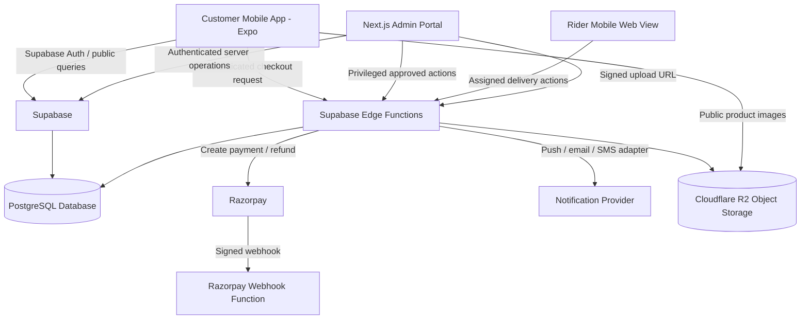
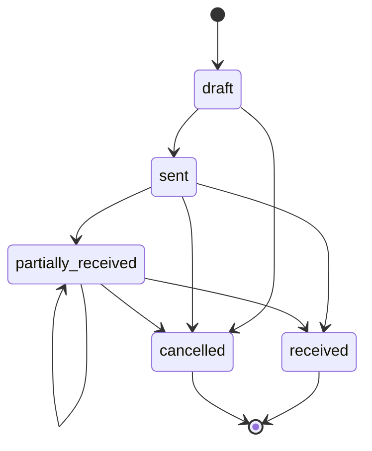
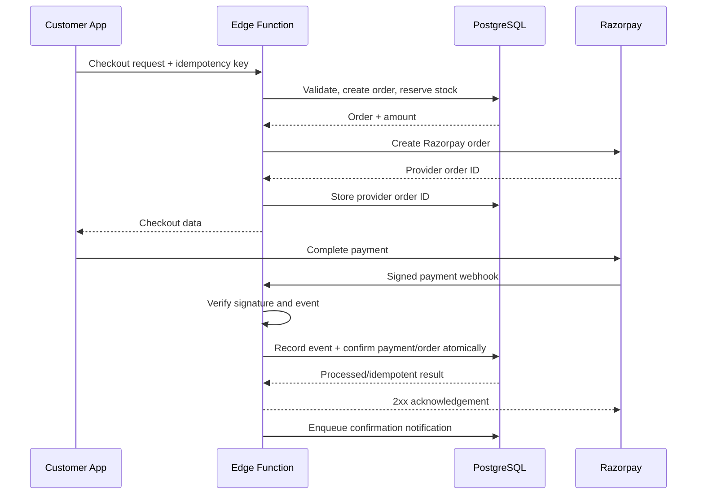
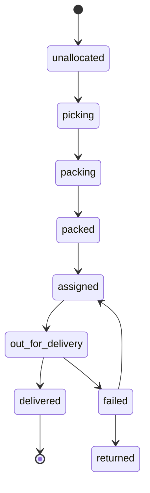

# SAMKRUSHI — Product, Architecture & Implementation Specification

**Document type:** Master implementation specification for AI coding agents  
**Version:** 1.0  
**Prepared:** 30 October 2026  
**Project:** Samkrushi — Farm-to-home fresh produce commerce platform  
**Initial market:** Hyderabad, Telangana, India  
**Document status:** Implementation baseline; legal, tax, payment-provider and deployment details must be verified before production.

---

## 0. Instructions to the AI coding agent

This document is the source of truth for the first implementation of Samkrushi. Read it fully before changing the repository or generating code.

### 0.1 Mandatory implementation rules

1. Implement the project in the phases in Section 17. Do not attempt to generate the entire application in one pass.
2. Before each phase, inspect the repository and report the existing state. Preserve working code unless a change is necessary and explain why.
3. Follow the architecture, database contracts, role boundaries, payment state machine and inventory rules in this document. Do not invent alternative flows without documenting the proposal and receiving approval.
4. Create database migrations for all schema changes. Never make undocumented manual production database changes.
5. Generate TypeScript types from the actual Supabase schema after migrations. Do not maintain a second handwritten copy of database table types.
6. Use strict TypeScript. Avoid `any`; validate untrusted inputs at API and Edge Function boundaries with shared Zod schemas.
7. Never expose Supabase service-role keys, payment secrets, R2 secrets, webhook secrets, or FCM service credentials to a mobile or browser bundle.
8. All prices, discounts, delivery fees, stock checks, inventory reservations and order totals must be calculated or validated on the server. Client-calculated values are display hints only.
9. All money values are stored as integer paise (`BIGINT`). All physical quantities use explicit units and suitable decimal precision (`NUMERIC`), never JavaScript floating-point arithmetic for money.
10. All inventory-affecting operations must be transactional, concurrency-safe and auditable. Do not deduct stock with an unguarded client-side update.
11. Payment webhooks must verify signatures against the raw request body, handle duplicates idempotently and verify amount, currency and internal order association before confirming an order.
12. Enforce authorization in database policies and server-side operations. A UI hide/show check or Next.js middleware alone is not authorization.
13. Add tests for critical business rules before marking a phase complete.
14. Keep an updated `README.md`, `.env.example`, setup instructions, migration notes and architecture decision records (`docs/adr/`) as the implementation evolves.
15. Do not silently add paid services, subscriptions, hidden infrastructure costs or external integrations. Identify the cost and ask for approval before adopting them.
16. Use currently supported stable versions of Expo, React Native, Next.js, Supabase libraries and other dependencies at implementation time. Do not pin the project to the old Expo SDK 52 merely because it appeared in an earlier draft. Check compatibility, pin resolved versions in the lockfile and document the chosen versions.
17. If a requirement is ambiguous, stop and list the ambiguity instead of inventing a business rule. Prefer configurable settings over hard-coded commercial rules.
18. Do not claim a legal or regulatory workflow is compliant merely because a page or field exists. Mark it as requiring review by the appropriate Indian professional or authority.

### 0.2 Expected output at the end of every phase

- Code and migrations for the phase.
- Automated tests and test results.
- Updated README/setup documentation.
- `.env.example` with variable names and safe placeholders only.
- A list of files created or changed.
- Any known gaps, assumptions, risks and manual actions still required.
- A clear statement of whether the phase acceptance criteria have passed.

### 0.3 Definition of done

A feature is not complete merely because a screen renders. It is complete only when validation, authorization, loading/error/empty states, persistence, auditability where applicable, tests and documentation are implemented.

---

# 1. Business context and product scope

## 1.1 Business concept

Samkrushi is a farm-to-home commerce business that sources fresh fruits and vegetables directly from farmers, farmer groups/FPOs and approved suppliers, then sells and delivers them to customers in Hyderabad.

The initial operating model is:

- Launch in one compact Hyderabad delivery zone.
- Start with approximately 25–40 high-demand products/SKUs.
- Onboard approximately 3–5 reliable farmers, FPOs or suppliers.
- Use an agreed farmer/supplier packing facility initially instead of establishing a separate warehouse.
- Use Samkrushi-controlled delivery staff for the initial delivery operation, with a backup delivery option when needed.
- Two founders operate the business initially; founder salaries are not included in the first-stage operating model.
- Build the technology in-house and keep infrastructure lean without compromising security, backups or payment correctness.

These are launch assumptions, not permanent technical limits. Keep the platform configurable so the business can add service zones, suppliers, packing facilities, products and delivery capacity later.

## 1.2 Product goals

1. Let customers discover and order fresh produce through a simple mobile experience.
2. Give Samkrushi staff a single web operations console for products, procurement, inventory, orders, packing, delivery and reporting.
3. Trace stock to its supplier and received batch.
4. Reduce stockouts, overselling, quality complaints and produce wastage.
5. Understand actual contribution per order and product, not just sales revenue.
6. Keep customer, payment, supplier and operational data protected by strict access rules.
7. Support future growth without prematurely building a complex multi-warehouse marketplace.

## 1.3 First-release scope

### Included in the first production release

- Customer Android application built with Expo/React Native, with an architecture that can also support iOS.
- Guest browsing of catalog and product details.
- Phone-based authentication using a supported Supabase Auth flow.
- Customer addresses and delivery-zone validation.
- Product catalog, search, category filters and cart.
- Fixed-weight or fixed-pack SKUs at launch (for example, 500 g, 1 kg, one bunch or one piece).
- Checkout with delivery slot, delivery charge and order notes.
- Razorpay domestic online payments and cash on delivery (COD), subject to business approval and gateway account activation.
- Customer order history and order status.
- Responsive Next.js admin dashboard.
- Admin-managed suppliers, purchase orders, goods receiving, quality inspection, batch inventory and stock adjustments.
- Packing/dispatch workflow at the supplier facility.
- Delivery-person records, order assignment and delivery confirmation.
- Refund and cancellation recording, with gateway refund integration where applicable.
- Push notifications and transactional communication.
- Daily operational and financial reports.
- Public privacy policy, terms, refund/cancellation, delivery and contact/support pages.
- Account deletion request flow.
- Audit logs, monitoring, backups and production deployment process.

### Explicitly deferred unless approved

- Open farmer self-service portal.
- Multiple warehouses or complex warehouse transfer management.
- Multiple cities or pan-India serviceability.
- International payment processing/Stripe.
- Subscription boxes, loyalty points and referral campaigns.
- AI recommendations or demand forecasting.
- Automated route optimization and live GPS tracking.
- Variable-weight checkout with a final charge different from the amount authorized at checkout.
- Marketplace commission settlement or third-party seller payouts.
- Complex coupon engine.

Do not let deferred features delay the first usable release. Design table and service boundaries so they can be added later without breaking order history.

## 1.4 Key launch decisions

| Area | First-release decision |
|---|---|
| Customer application | Expo React Native; Android-first release, iOS-compatible structure |
| Admin | Next.js responsive web dashboard |
| Backend | Supabase PostgreSQL, Auth and Edge Functions |
| Product/image assets | Cloudflare R2 or another approved object store with signed uploads |
| Payments | Razorpay first; Stripe deferred |
| Notifications | Expo Notifications initially; direct FCM integration only if a concrete need arises |
| Inventory | Batch-based inventory with reservations and movement ledger |
| Launch stock | Fixed packs/SKUs to avoid post-payment price adjustments |
| Packing | Supplier/farmer facility recorded as a fulfilment/packing location |
| Delivery | Staff assignment from admin; mobile-friendly rider views |
| Serviceability | Configurable PIN-code and delivery-zone mapping |
| Initial operations | One delivery zone, small catalog, limited supplier group |

---

# 2. User roles and permissions

Use explicit roles and least-privilege authorization. Do not use a user-editable `is_admin` boolean in the customer profile table.

## 2.1 Roles

| Role | Scope |
|---|---|
| `customer` | Browse public catalog, manage own profile/addresses, place orders, see own orders and request support |
| `super_admin` | Full business configuration and user-role administration |
| `operations_admin` | Products, suppliers, procurement, batches, inventory, orders and packing |
| `finance_admin` | Payment reconciliation, refunds, supplier payments and financial reports |
| `dispatch_admin` | Delivery slots, delivery people, assignments and delivery exceptions |
| `support_agent` | Customer/order support with only the minimum required customer information |
| `rider` | See only assigned deliveries and the minimum information needed to complete them |

A person may have more than one role. Role assignment is performed only through a trusted administrative process, never from the customer application.

## 2.2 Authorization requirements

- Store roles in a protected `user_roles` table or trusted server-issued claims.
- Customers cannot read or update role assignments.
- Riders cannot query all orders, all customers, all addresses or supplier financial data.
- Support staff cannot modify payment records or supplier costs.
- Finance staff cannot silently change inventory quantities.
- Admin routes and server actions must verify the role on the server for every protected operation.
- Database RLS must enforce row-level access for exposed tables.
- Sensitive admin changes must create an audit-log entry.

---

# 3. System architecture

## 3.1 High-level architecture



## 3.2 Responsibilities by layer

### Customer mobile app

- Presentation, navigation, cart UX and local caching.
- Never decides final price, stock availability or user authorization.
- Calls server functions for checkout, cancellation requests, account deletion and other sensitive operations.
- Uses Supabase Auth session for customer identity.

### Admin web portal

- Business operations interface.
- Authenticated role-specific routes.
- Calls server-side operations/Edge Functions for privileged workflows.
- Does not expose service-role keys in browser JavaScript.
- Uses RLS-backed reads wherever practical.

### Supabase PostgreSQL

- System of record for catalog, supplier records, inventory, orders, payments, delivery, configuration and audit data.
- Enforces constraints, transactional operations, RLS and database functions.
- Stores monetary values as paise and quantities with explicit units.

### Supabase Edge Functions

- Trusted server-side boundary for order creation, payment initiation, webhooks, inventory reservations, refunds, notifications and account deletion orchestration.
- Validates input and caller role.
- Uses secret values only from server-side secrets.
- Delegates atomic stock/order operations to carefully reviewed PostgreSQL functions.

### Cloudflare R2

- Stores product images and approved operational documents.
- Private uploads use short-lived signed upload URLs.
- Public product images may be served from a public-read CDN bucket/path.
- Never make supplier invoices or customer documents publicly readable.

### Payment provider

- Razorpay is the only payment provider required for initial release.
- Stripe integration is deferred. Define a payment-provider adapter boundary so a second gateway can be added later without changing order-domain logic.

### Notifications

- Use an `notification_outbox` record created as part of successful domain operations.
- A worker/Edge Function sends notifications and marks delivery attempts.
- Failed notifications must not reverse a paid order or inventory operation.

## 3.3 Monorepo structure

```text
samkrushi/
├── apps/
│   ├── mobile/                         # Expo React Native customer application
│   │   ├── app/                         # Expo Router routes
│   │   ├── src/
│   │   │   ├── components/
│   │   │   ├── features/
│   │   │   │   ├── auth/
│   │   │   │   ├── catalog/
│   │   │   │   ├── cart/
│   │   │   │   ├── checkout/
│   │   │   │   ├── orders/
│   │   │   │   └── profile/
│   │   │   ├── hooks/
│   │   │   ├── services/
│   │   │   ├── store/
│   │   │   └── utils/
│   │   ├── assets/
│   │   └── package.json
│   └── admin-web/                      # Next.js admin and rider-responsive views
│       ├── app/
│       │   ├── (auth)/
│       │   ├── (dashboard)/
│       │   │   ├── overview/
│       │   │   ├── products/
│       │   │   ├── categories/
│       │   │   ├── suppliers/
│       │   │   ├── procurement/
│       │   │   ├── goods-receipts/
│       │   │   ├── inventory/
│       │   │   ├── orders/
│       │   │   ├── packing/
│       │   │   ├── deliveries/
│       │   │   ├── customers/
│       │   │   ├── refunds/
│       │   │   ├── reports/
│       │   │   ├── users-and-roles/
│       │   │   ├── settings/
│       │   │   └── audit-logs/
│       │   ├── rider/                  # Mobile-friendly restricted rider experience
│       │   └── (public)/               # Legal/support pages
│       ├── src/
│       │   ├── components/
│       │   ├── features/
│       │   ├── lib/
│       │   ├── server/
│       │   └── middleware.ts           # Optional UX routing only, not sole authorization
│       └── package.json
├── packages/
│   ├── shared/                         # Domain types, Zod schemas, constants
│   ├── ui/                             # Optional shared design primitives
│   └── tsconfig/
├── supabase/
│   ├── config.toml
│   ├── migrations/
│   ├── functions/
│   ├── seed.sql
│   └── tests/                          # SQL/RLS tests where supported
├── docs/
│   ├── adr/
│   ├── runbooks/
│   └── api-contracts/
├── .github/workflows/
├── .env.example
├── package.json
├── pnpm-workspace.yaml
├── turbo.json
└── README.md
```

Use `pnpm` workspaces and Turborepo if they remain useful for the repository size. Keep mobile and web dependency boundaries clear. Do not import browser-only libraries into mobile code or React Native modules into Next.js server code.

---

# 4. Technology stack and implementation standards

| Layer | Technology | Requirements |
|---|---|---|
| Monorepo | pnpm workspaces + Turborepo | Reproducible lockfile and filtered scripts |
| Mobile | React Native + Expo + TypeScript | Currently supported stable Expo SDK; Expo Router |
| Admin | Next.js App Router + TypeScript | Server Components by default; client components only when needed |
| Styling | Tailwind CSS for web; React Native styling approach for mobile | Shared design tokens where practical |
| Database | Supabase PostgreSQL | Migrations, indexes, constraints and RLS |
| Authentication | Supabase Auth | Phone OTP or approved supported method; abuse protection |
| Validation | Zod | Shared schemas and server-side validation |
| Client state | Zustand | Cart and transient UI state only |
| Server state | TanStack Query | Query caching, invalidation and retry rules |
| Forms | React Hook Form + Zod (recommended) | Accessible validation |
| Image storage | Cloudflare R2 | Short-lived signed uploads and controlled public delivery |
| Payments | Razorpay | Server-created orders, signature verification, refunds and reconciliation |
| Push notifications | Expo Notifications initially | Store tokens per device and handle invalid tokens |
| Tests | Vitest/Jest as appropriate, React Native Testing Library, Playwright | Unit, integration, RLS and end-to-end tests |
| Observability | Approved error/logging tool | Scrub PII and secrets from logs |

### 4.1 Data conventions

- Database primary keys: UUID.
- Timestamps: `TIMESTAMPTZ`, stored in UTC; display in `Asia/Kolkata`.
- Currency: INR, store paise as `BIGINT`; format as rupees only at presentation boundaries.
- Physical quantities: `NUMERIC(12,3)` or suitable higher precision and an explicit unit code.
- Phone numbers: normalize to E.164 where possible; do not use them as a primary key.
- IDs and enum values: stable lowercase snake_case in database.
- API JSON: camelCase externally; map consistently to database names.
- Never use floating-point values for monetary calculations.
- Record snapshots of product name, SKU, price, unit and tax classification in order items so historical orders remain accurate after catalog edits.

### 4.2 Time and business-day handling

- Store timestamps in UTC.
- Use `Asia/Kolkata` for customer-facing dates, cut-off rules, delivery slots and reports.
- Do not rely on device-local time for order cut-off or slot availability. Validate on the server.

---

# 5. Application experience and screens

## 5.1 Customer mobile application

### Public/guest screens

- Home/catalog landing page.
- Category listing.
- Search results.
- Product detail.
- Cart.
- Login/OTP entry.
- Public delivery/serviceability check.
- Public policy, support and contact links (may open the web pages).

### Authenticated screens

- Address book and address form.
- Checkout review.
- Delivery date/time slot selection.
- Payment selection (online/COD where allowed).
- Order confirmation.
- Order history and order details.
- Order status tracking.
- Customer profile and preferences.
- Help, complaint and refund request.
- Account deletion request.

### Customer UX requirements

- Guest users may browse products and add to a local cart.
- Require authentication before final order creation.
- Cart persists locally using Zustand persistence and secure/appropriate storage.
- Revalidate all cart items, price, availability, service zone and delivery slot on the server at checkout.
- Show product unit clearly (for example, 500 g, 1 kg, 1 bunch, 1 piece).
- Show whether an item is temporarily unavailable or has limited stock without revealing supplier purchase costs.
- Show total price breakdown: items, discounts, delivery charge, taxes if configured, and final amount.
- Explain cancellation, substitution and refund rules before payment.
- Display order status from the server, not from a client-side optimistic assumption.
- Provide accessible error messages and a recoverable retry path for network/payment issues.

### Mobile navigation proposal

```text
app/
├── (public)/
│   ├── index.tsx
│   ├── search.tsx
│   ├── category/[slug].tsx
│   └── product/[id].tsx
├── (auth)/
│   ├── login.tsx
│   └── verify-otp.tsx
├── (customer)/
│   ├── _layout.tsx
│   ├── (tabs)/
│   │   ├── index.tsx
│   │   ├── categories.tsx
│   │   ├── cart.tsx
│   │   └── profile.tsx
│   ├── checkout/
│   │   ├── address.tsx
│   │   ├── delivery-slot.tsx
│   │   ├── review.tsx
│   │   └── payment.tsx
│   ├── orders/index.tsx
│   ├── orders/[id].tsx
│   └── addresses/index.tsx
└── +not-found.tsx
```

## 5.2 Admin web portal

### Overview dashboard

- Today's orders and sales.
- Orders awaiting confirmation, picking, packing or dispatch.
- Low-stock and out-of-stock products.
- Batches nearing sell-by/expiry date.
- Wastage and rejected quantities.
- Delivery exceptions.
- Payment failures and unreconciled transactions.
- Contribution and operating metrics.

### Product/catalog management

- Create/edit/archive categories and products.
- SKU, product name, description, images and category.
- Sale unit and fixed pack size.
- Retail price in paise, active/published flag, tax classification and tax configuration reference.
- Minimum/maximum order quantity and increment.
- Product origin/seasonal notes where known.
- Product tags such as seasonal or local; do not claim “organic” unless the business has appropriate substantiation/certification and legal approval.

### Supplier management

- Supplier profile and contacts.
- Supplier type (farmer, FPO, aggregator or other approved source).
- Farm/collection/packing location.
- Active/inactive status.
- Product sourcing relationships.
- Agreed quality specifications and typical lead time.
- Bank/payment details restricted to finance roles.
- Supplier documents, agreements and verification status.
- Supplier scorecard: rejection rate, on-time rate, price trend and complaint rate.

### Procurement

- Create purchase orders.
- Add supplier, expected delivery date, items, requested quantity and agreed cost.
- Track draft, sent, partially received, received, cancelled states.
- Record supplier invoice/reference number.
- Receive goods against a purchase order.
- Create one or more goods-receipt records for partial deliveries.
- Record received, accepted, rejected and damaged quantities.
- Record quality grade, notes and images when relevant.
- Create separate stock batches for accepted goods.
- Record supplier payable and payment status.

### Inventory and batch management

- View available, reserved, damaged, rejected and expired stock by product and batch.
- Filter by supplier, location, receipt date and sell-by date.
- Apply FEFO (first-expiring, first-out) for perishable lots where an expiry/sell-by date is available; otherwise use documented FIFO rules.
- Adjust inventory only with a reason and audit record.
- Support wastage, damage, sample use, count correction and expiry write-off movement types.
- Prevent negative available stock.
- Show on-hand stock from the inventory movement ledger and available-to-promise stock as on-hand less active reservations; a reservation release changes availability through reservation state, not through a stock movement. Do not allow arbitrary stock overwrite without an adjustment movement.

### Order operations

- Search/filter orders by date, status, customer, payment state and delivery slot.
- View immutable order-item snapshots and payment history.
- Accept/confirm eligible orders.
- Start picking and packing.
- Record picked quantities and substitutions where allowed.
- Mark packed and assign delivery.
- Cancel eligible orders and initiate refund workflow.
- Record customer contact and exception notes.
- View full status history.

### Delivery operations

- Manage delivery people and active status.
- Configure delivery zones and slots.
- View dispatch board grouped by slot/zone.
- Assign and reassign orders.
- Record out-for-delivery, delivered, failed, customer-unavailable and returned-to-facility states.
- Confirm delivery via one-time customer OTP or another approved proof-of-delivery method.
- Rider view shows only assigned orders and the minimum information required to complete them.
- Record COD amount due, cash collected, cash deposited and reconciliation status.

### Finance and reporting

- Gross sales, discounts, delivery fees and refunds.
- Net sales.
- Actual cost of goods sold from batch cost allocation.
- Packing material and packing labor costs.
- Payment gateway charges (manual import/configurable initially if API data is unavailable).
- Delivery cost per order/route/slot.
- Wastage and write-off cost.
- Contribution by order, SKU, category and date.
- Supplier payable ageing and payment history.
- Operating expenses and cost-category summary.
- COD reconciliation.
- Gateway settlement reconciliation.

### Settings

- Store name and support contacts.
- Service zones/PIN codes.
- Delivery slots and capacity.
- Order cut-off times.
- Minimum order value.
- Delivery fee rules.
- COD availability rules and maximum COD amount (configurable).
- Substitution policy.
- Cancellation/refund policy text/version.
- Tax configuration set by an authorized finance/admin role after professional review.
- Store operating hours and temporary pause switch.

## 5.3 Rider experience

For the initial release, use a mobile-friendly restricted route within the admin web application rather than building a separate rider app.

Rider screens:

- Sign in.
- Today's assigned deliveries.
- Delivery list ordered by slot/route sequence (manual ordering initially).
- Delivery detail with customer name, phone, address, amount due and delivery notes.
- Call customer action.
- Mark out for delivery.
- Enter delivery OTP or record approved proof of delivery.
- Mark failed with a required reason.
- COD collected amount entry.

Rider authorization must be enforced on the server and in RLS. A rider must not be able to change price, payment status, item quantities or order assignment.

---

# 6. Agricultural procurement, quality and packing workflows

## 6.1 Supplier onboarding

1. Admin creates supplier record.
2. Capture supplier identity/contact, type, sourcing location and authorized contacts.
3. Capture products supplied, expected seasonality, indicative rates and lead time.
4. Upload applicable agreements/verification documents to private storage.
5. Record verification state and who verified the supplier.
6. Activate supplier only after required business checks are complete.

## 6.2 Purchase order workflow



Rules:

- Purchase order creation does not add stock.
- Only accepted quantity on a goods receipt creates saleable inventory.
- A purchase order may be received in multiple deliveries.
- The system must preserve ordered, received, accepted and rejected quantities separately.
- Supplier invoice amount and agreed purchase cost must be stored for finance reconciliation.

## 6.3 Goods receiving and quality inspection

At the supplier/packing facility, an authorized Samkrushi operator records:

- Purchase order and supplier.
- Product and batch/lot identity.
- Received quantity and unit.
- Accepted quantity.
- Rejected quantity.
- Damaged quantity.
- Quality grade and inspection notes.
- Received date/time and operator.
- Harvest/collection date when supplied and verifiable.
- Estimated sell-by/expiry date only when meaningful and determined by an approved operating policy.
- Photographic evidence for material rejection or quality disputes, stored privately.

Accepted stock becomes a batch. Rejected stock must never be available to customer orders.

## 6.4 Batch and stock rotation

- Each stock batch belongs to a product and supplier and optionally to a packing/fulfilment facility.
- Allocate reservations from eligible batches according to FEFO where reliable sell-by/expiry dates exist; otherwise use FIFO.
- Do not represent harvest date as an expiry date.
- Batches that are expired, recalled, on hold or quality-blocked cannot be reserved.
- Stock adjustment requires a movement type, reason, actor and timestamp.
- Every stock-changing transaction must write a matching inventory movement record.

## 6.5 Packing workflow

1. Orders assigned to a delivery slot appear in the picking/packing queue.
2. Picker receives product, pack-size and quantity list.
3. Picker selects eligible batches using FEFO/FIFO rules.
4. Items are packed into approved clean packaging.
5. Operator records packed quantity and any discrepancy.
6. If an item is unavailable or below quality standard, use the substitution workflow; do not silently substitute.
7. Final packing confirmation changes fulfillment status to `packed`.
8. Packed orders become available for delivery assignment.

## 6.6 Fixed packs at launch; variable weight later

**Launch rule:** sell fixed pack/SKU quantities (for example 500 g bag, 1 kg bag, one bunch). The order amount is known before payment and should not change after payment.

**Future capability:** actual-weight fulfilment may be added only after defining a customer-approved price adjustment policy and the payment/refund collection method. Do not implement a flow that charges a different amount from the customer-approved checkout total without explicit customer consent and a legally/provider-approved payment mechanism.

---

# 7. Data model and database design

All tables must have explicit primary keys, timestamps where applicable, constraints, indexes and RLS policies. The following is the required logical schema. The implementation agent should translate it into sequential SQL migrations and generated TypeScript types. Pay attention to dependency order: create `orders` and `order_items` before `inventory_reservations`, even though the logical schema is grouped by business domain. If necessary, add a foreign key in a later migration after both tables exist.

## 7.1 Core enums / controlled values

Use PostgreSQL enums or validated lookup tables consistently. Initial values:

- `app_role`: `customer`, `super_admin`, `operations_admin`, `finance_admin`, `dispatch_admin`, `support_agent`, `rider`.
- `supplier_type`: `farmer`, `fpo`, `aggregator`, `wholesaler`, `other`.
- `purchase_order_status`: `draft`, `sent`, `partially_received`, `received`, `cancelled`.
- `goods_receipt_status`: `draft`, `inspected`, `posted`, `cancelled`.
- `batch_status`: `active`, `on_hold`, `recalled`, `expired`, `depleted`.
- `inventory_movement_type`: `receipt`, `sale`, `wastage`, `damage`, `expiry`, `adjustment_increase`, `adjustment_decrease`, `sample`, `return_to_stock`. Reservations are tracked only in `inventory_reservations`, not as on-hand ledger movements.
- `order_status`: `pending_payment`, `confirmed`, `processing`, `packed`, `out_for_delivery`, `delivered`, `cancelled`, `delivery_failed`, `returned`.
- `payment_status`: `not_required`, `pending`, `authorized`, `captured`, `failed`, `partially_refunded`, `refunded`, `cash_due`, `cash_collected`.
- `payment_method`: `razorpay`, `cod` (do not add Stripe to the launch enum unless integration is approved).
- `fulfillment_status`: `unallocated`, `picking`, `packing`, `packed`, `assigned`, `out_for_delivery`, `delivered`, `failed`, `returned`.
- `payment_event_status`: `received`, `processed`, `ignored`, `failed`.
- `refund_status`: `requested`, `pending`, `processed`, `failed`, `cancelled`.
- `delivery_assignment_status`: `assigned`, `accepted`, `picked_up`, `delivered`, `failed`, `reassigned`, `cancelled`.

Keep order, payment and fulfillment states separate. Do not overload one status column to represent all three lifecycles.

## 7.2 Identity and access tables

### `profiles`

- `id UUID PRIMARY KEY REFERENCES auth.users(id) ON DELETE CASCADE`
- `full_name TEXT`
- `phone_number TEXT`
- `email TEXT NULL`
- `created_at`, `updated_at TIMESTAMPTZ`

Do not include an editable `is_admin` column. Profile updates must be limited to customer-editable fields.

### `user_roles`

- `id UUID PRIMARY KEY`
- `user_id UUID REFERENCES auth.users(id)`
- `role app_role`
- `assigned_by UUID NULL`
- `created_at TIMESTAMPTZ`
- Unique constraint on `(user_id, role)`.

Only a trusted server-side role administration operation or controlled database seed may assign privileged roles.

### `addresses`

- `id UUID PRIMARY KEY`
- `user_id UUID REFERENCES profiles(id)`
- `recipient_name`, `phone`, `street_line1`, `street_line2`, `landmark`
- `city`, `state`, `postal_code`, `address_label`
- `latitude NUMERIC NULL`, `longitude NUMERIC NULL` (optional and consent-aware)
- `is_default BOOLEAN`
- `created_at`, `updated_at`

A customer may read/write only their own addresses. A rider may receive only the address needed for an assigned delivery through a restricted server operation.

## 7.3 Catalog tables

### `categories`

- `id UUID PRIMARY KEY`
- `name TEXT`, `slug TEXT UNIQUE`
- `description TEXT NULL`, `image_key TEXT NULL`
- `display_order INT`, `is_active BOOLEAN`
- `created_at`, `updated_at`

### `products`

Each row represents a sellable SKU/pack in the launch model. Different pack sizes may be separate product rows.

- `id UUID PRIMARY KEY`
- `category_id UUID REFERENCES categories(id)`
- `title TEXT`, `slug TEXT UNIQUE`, `description TEXT`
- `sku TEXT UNIQUE`
- `sale_unit_code TEXT` (pack, piece, bunch, dozen; controlled list used for customer display)
- `inventory_unit_code TEXT` (kg, g, piece, bunch; controlled list used for physical stock)
- `pack_quantity NUMERIC(12,3)` = number of inventory units in one sellable sale unit
- `price_paise BIGINT CHECK (price_paise >= 0)`
- `compare_at_price_paise BIGINT NULL`
- `minimum_order_quantity NUMERIC(12,3)`
- `order_quantity_step NUMERIC(12,3)`
- `maximum_order_quantity NUMERIC(12,3) NULL`
- `pricing_mode TEXT` initially `fixed_pack`
- `tax_code TEXT NULL` and a reference to approved tax configuration if required
- `origin_label TEXT NULL`
- `is_seasonal BOOLEAN`, `is_published BOOLEAN`, `is_active BOOLEAN`
- `created_at`, `updated_at`

Do not store supplier purchase cost in the public product row. Product public queries must not expose internal cost/margin information. For a sellable SKU, customer order quantities use `sale_unit_code`; procurement, batches, inventory movements and reservations use `inventory_unit_code`. Convert from sale units to stock units using `pack_quantity` on the server.

### `product_images`

- `id UUID PRIMARY KEY`
- `product_id UUID REFERENCES products(id)`
- `object_key TEXT`
- `alt_text TEXT NULL`
- `display_order INT`
- `created_at`

Do not store expiring signed URLs as permanent product image references. Store object keys and resolve public or signed URLs when needed.

## 7.4 Supplier and packing location tables

### `suppliers`

- `id UUID PRIMARY KEY`
- `supplier_code TEXT UNIQUE`
- `name TEXT`
- `supplier_type supplier_type`
- `contact_name TEXT NULL`
- `phone TEXT`, `email TEXT NULL`
- `address fields`, `postal_code TEXT`
- `status TEXT` (pending, active, suspended, inactive)
- `verification_notes TEXT NULL`
- `created_at`, `updated_at`

### `supplier_products`

- `id UUID PRIMARY KEY`
- `supplier_id UUID REFERENCES suppliers(id)`
- `product_id UUID REFERENCES products(id)`
- `indicative_cost_paise BIGINT NULL`
- `lead_time_hours INT NULL`
- `minimum_supply_quantity NUMERIC(12,3) NULL`
- `is_active BOOLEAN`
- Unique constraint on `(supplier_id, product_id)`.

### `fulfillment_locations`

- `id UUID PRIMARY KEY`
- `name TEXT`
- `location_type TEXT` (supplier_facility, collection_point, future_warehouse)
- `supplier_id UUID NULL REFERENCES suppliers(id)`
- `address fields`, `postal_code TEXT`
- `is_active BOOLEAN`
- `created_at`, `updated_at`

A supplier's packing facility should be represented here. More than one location can be added later.

## 7.5 Procurement tables

### `purchase_orders`

- `id UUID PRIMARY KEY`
- `purchase_order_number TEXT UNIQUE`
- `supplier_id UUID REFERENCES suppliers(id)`
- `fulfillment_location_id UUID REFERENCES fulfillment_locations(id)`
- `status purchase_order_status`
- `ordered_at TIMESTAMPTZ`, `expected_at TIMESTAMPTZ NULL`
- `supplier_reference TEXT NULL`
- `notes TEXT NULL`
- `created_by UUID`, `created_at`, `updated_at`

### `purchase_order_items`

- `id UUID PRIMARY KEY`
- `purchase_order_id UUID REFERENCES purchase_orders(id)`
- `product_id UUID REFERENCES products(id)`
- `ordered_quantity NUMERIC(12,3)`
- `inventory_unit_code TEXT`
- `unit_cost_paise BIGINT` (per inventory unit)
- `line_total_paise BIGINT`
- `created_at`

### `goods_receipts`

- `id UUID PRIMARY KEY`
- `receipt_number TEXT UNIQUE`
- `purchase_order_id UUID REFERENCES purchase_orders(id)`
- `supplier_id UUID REFERENCES suppliers(id)`
- `fulfillment_location_id UUID REFERENCES fulfillment_locations(id)`
- `status goods_receipt_status`
- `supplier_invoice_reference TEXT NULL`
- `received_at TIMESTAMPTZ`
- `inspected_by UUID NULL`, `posted_by UUID NULL`
- `notes TEXT NULL`
- `created_at`, `updated_at`

### `goods_receipt_items`

- `id UUID PRIMARY KEY`
- `goods_receipt_id UUID REFERENCES goods_receipts(id)`
- `purchase_order_item_id UUID NULL REFERENCES purchase_order_items(id)`
- `product_id UUID REFERENCES products(id)`
- `quantity_received NUMERIC(12,3)`
- `quantity_accepted NUMERIC(12,3)`
- `quantity_rejected NUMERIC(12,3)`
- `quantity_damaged NUMERIC(12,3)`
- `inventory_unit_code TEXT`
- `unit_cost_paise BIGINT` (per inventory unit)
- `quality_grade TEXT NULL`, `inspection_notes TEXT NULL`
- `created_at`

Constraint: accepted + rejected + damaged quantities must not exceed received quantity; any unclassified balance must be explicitly resolved before posting.

### `supplier_payments`

- `id UUID PRIMARY KEY`
- `supplier_id UUID REFERENCES suppliers(id)`
- `purchase_order_id UUID NULL REFERENCES purchase_orders(id)`
- `goods_receipt_id UUID NULL REFERENCES goods_receipts(id)`
- `amount_paise BIGINT CHECK (amount_paise > 0)`
- `payment_method TEXT` (bank_transfer, UPI_business, cash, other; restrict according to finance policy)
- `payment_reference TEXT NULL`
- `status TEXT` (pending, processed, failed, cancelled)
- `paid_at TIMESTAMPTZ NULL`
- `created_by UUID`, `approved_by UUID NULL`
- `notes TEXT NULL`
- `created_at`, `updated_at`

Supplier payment creation/approval must be restricted to finance roles and recorded in the audit log. Do not store bank credentials or UPI PINs.

## 7.6 Batch inventory tables

### `product_batches`

- `id UUID PRIMARY KEY`
- `batch_code TEXT UNIQUE`
- `product_id UUID REFERENCES products(id)`
- `supplier_id UUID REFERENCES suppliers(id)`
- `fulfillment_location_id UUID REFERENCES fulfillment_locations(id)`
- `goods_receipt_item_id UUID REFERENCES goods_receipt_items(id)`
- `received_quantity NUMERIC(12,3)`
- `inventory_unit_code TEXT`
- `unit_cost_paise BIGINT` (cost per inventory unit; for example, paise per kg)
- `harvested_at DATE NULL`
- `received_at TIMESTAMPTZ`
- `sell_by_date DATE NULL`
- `status batch_status`
- `quality_grade TEXT NULL`
- `created_at`, `updated_at`

### `product_recalls`

- `id UUID PRIMARY KEY`
- `recall_number TEXT UNIQUE`
- `reason TEXT`
- `status TEXT` (open, investigating, actioned, closed)
- `initiated_by UUID`
- `started_at TIMESTAMPTZ`
- `closed_at TIMESTAMPTZ NULL`
- `resolution_notes TEXT NULL`

A recall case must identify affected batches and support a query of orders that consumed stock from those batches. Implement `product_recall_batches(recall_id, batch_id)` as a junction table, and record customer/supplier contact actions as required by the approved recall procedure.

### `inventory_movements`

- `id UUID PRIMARY KEY`
- `product_id UUID REFERENCES products(id)`
- `batch_id UUID NULL REFERENCES product_batches(id)`
- `location_id UUID NULL REFERENCES fulfillment_locations(id)`
- `movement_type inventory_movement_type`
- `quantity_delta NUMERIC(12,3)` signed where appropriate
- `inventory_unit_code TEXT`
- `reference_type TEXT NULL`, `reference_id UUID NULL`
- `reason TEXT NULL`
- `actor_user_id UUID NULL`
- `created_at TIMESTAMPTZ`

Use this as the immutable stock movement ledger. Prefer append-only records; corrections should be compensating movements, not editing historical movements.

### `inventory_reservations`

- `id UUID PRIMARY KEY`
- `order_item_id UUID REFERENCES order_items(id)`
- `batch_id UUID REFERENCES product_batches(id)`
- `reserved_quantity NUMERIC(12,3)`
- `inventory_unit_code TEXT`
- `status TEXT` (active, consumed, released, expired)
- `expires_at TIMESTAMPTZ`
- `created_at`, `updated_at`

A reservation must refer to an order item and batch. Reservation creation/release/consumption must be controlled by database transactions/functions. No negative available quantity is permitted. The reservation quantity is always in the product's `inventory_unit_code`, not the customer-facing sale-unit count.

**Required stock calculation semantics:**

- Product `pack_quantity` tells the system how many inventory units are consumed by one customer sale unit. Example: one 1 kg pack has `pack_quantity = 1` and inventory unit `kg`; ordering 3 packs reserves 3 kg.
- `inventory_movements` is the immutable on-hand ledger. A posted accepted goods receipt adds a positive `receipt` movement. Sale/consumption, wastage, damage, expiry and adjustment movements alter on-hand quantity.
- `inventory_reservations` is a separate commitment ledger. Active, unexpired reservations reduce available-to-promise but do not reduce on-hand quantity. Reservation creation does not also create a permanent negative inventory movement.
- `on_hand_quantity` = sum of posted inventory movement deltas for that batch.
- `reserved_quantity` = sum of all reservations whose status is `active`. An `expires_at` timestamp makes a reservation eligible for expiry processing, but it must continue to count against availability until a trusted expiry/reconciliation transaction explicitly changes its status to `released` or `expired`.
- `available_quantity` = `on_hand_quantity - reserved_quantity`; it must never be negative.
- When an order is picked/packed and its reservation is consumed, one transaction marks the reservation consumed and posts one negative `sale` movement. This reduces on-hand and removes the reservation by the same amount, so available stock does not change unexpectedly.
- When a reservation is released, mark it released/expired without a stock movement; available stock increases because the reservation no longer counts.
- Implement these calculations in database views/functions or a tested service. Do not maintain conflicting independent stock totals.

## 7.7 Customer commerce and order tables

### `service_zones`

- `id UUID PRIMARY KEY`
- `name TEXT`
- `city TEXT`, `state TEXT`
- `is_active BOOLEAN`
- `created_at`, `updated_at`

### `serviceable_postal_codes`

- `postal_code TEXT PRIMARY KEY`
- `service_zone_id UUID REFERENCES service_zones(id)`
- `is_active BOOLEAN`
- `default_delivery_fee_paise BIGINT`
- `minimum_order_value_paise BIGINT`
- `created_at`, `updated_at`

A future version may add polygon-based zones. For launch, PIN-code mapping plus manual exception handling is sufficient.

### `delivery_slots`

- `id UUID PRIMARY KEY`
- `service_zone_id UUID REFERENCES service_zones(id)`
- `slot_date DATE`
- `start_time TIME`, `end_time TIME`
- `cutoff_at TIMESTAMPTZ`
- `capacity_orders INT`
- `booked_order_count INT DEFAULT 0`, maintained transactionally under a row lock
- `is_active BOOLEAN`
- Unique constraint on zone/date/start/end. Enforce `0 <= booked_order_count <= capacity_orders`.

Do not trust client-side slot capacity. Slot reservation must be atomic.

### `orders`

- `id UUID PRIMARY KEY`
- `order_number TEXT UNIQUE`
- `user_id UUID REFERENCES profiles(id)`
- `service_zone_id UUID REFERENCES service_zones(id)`
- `delivery_slot_id UUID REFERENCES delivery_slots(id)`
- `order_status order_status`
- `payment_status payment_status`
- `fulfillment_status fulfillment_status`
- `payment_method payment_method`
- `currency_code TEXT DEFAULT 'INR'`
- `subtotal_paise BIGINT`
- `discount_paise BIGINT DEFAULT 0`
- `delivery_fee_paise BIGINT DEFAULT 0`
- `tax_paise BIGINT DEFAULT 0`
- `total_paise BIGINT`
- `shipping_address_snapshot JSONB`
- `customer_notes TEXT NULL`
- `cancellation_reason TEXT NULL`
- `idempotency_key TEXT`
- Unique constraint on `(user_id, idempotency_key)` so a retry cannot create a second order for the same checkout request.
- `placed_at TIMESTAMPTZ`, `confirmed_at TIMESTAMPTZ NULL`, `delivered_at TIMESTAMPTZ NULL`
- `created_at`, `updated_at`

Constraints: all monetary amounts must be nonnegative unless there is an explicit signed adjustment table. Check total reconciliation according to the approved pricing/tax formula.

### `order_items`

- `id UUID PRIMARY KEY`
- `order_id UUID REFERENCES orders(id)`
- `product_id UUID REFERENCES products(id)`
- `product_title_snapshot TEXT`
- `sku_snapshot TEXT`
- `sale_unit_code_snapshot TEXT`
- `inventory_unit_code_snapshot TEXT`
- `pack_quantity_snapshot NUMERIC(12,3)`
- `unit_price_paise BIGINT`
- `ordered_quantity NUMERIC(12,3)` (number of sale units/packs ordered)
- `fulfilled_quantity NUMERIC(12,3) NULL` (number of sale units/packs fulfilled)
- `line_total_paise BIGINT`
- `allocated_cogs_paise BIGINT NULL` (final actual cost allocation)
- `created_at`

The order line must remain historically accurate if the live product name, price or unit later changes.

### `order_status_history`

- `id UUID PRIMARY KEY`
- `order_id UUID REFERENCES orders(id)`
- `old_order_status`, `new_order_status`
- `old_payment_status`, `new_payment_status`
- `old_fulfillment_status`, `new_fulfillment_status`
- `changed_by UUID NULL`
- `source TEXT` (customer, admin, rider, payment_webhook, system)
- `reason TEXT NULL`
- `created_at TIMESTAMPTZ`

Every meaningful status transition must be recorded.

### `customer_substitutions`

- `id UUID PRIMARY KEY`
- `order_item_id UUID REFERENCES order_items(id)`
- `requested_product_id UUID NULL REFERENCES products(id)`
- `replacement_product_id UUID NULL REFERENCES products(id)`
- `customer_decision TEXT` (allow_similar, contact_me, no_substitution)
- `status TEXT` (proposed, accepted, rejected, cancelled)
- `price_difference_paise BIGINT DEFAULT 0`
- `notes TEXT NULL`
- `created_at`, `updated_at`

At launch, do not automatically substitute an item without customer permission. If a substitution changes the total, obtain customer approval and use a clear refund/additional-payment process; otherwise offer a same-price substitution or remove/refund the item.

## 7.8 Payment and refund tables

### `payments`

- `id UUID PRIMARY KEY`
- `order_id UUID REFERENCES orders(id)`
- `provider TEXT` (razorpay initially)
- `provider_order_id TEXT UNIQUE`
- `provider_payment_id TEXT UNIQUE NULL`
- `amount_paise BIGINT`
- `currency_code TEXT DEFAULT 'INR'`
- `status payment_status`
- `created_at`, `updated_at`

Do not store card numbers, UPI PINs, CVVs or other prohibited payment credentials.

### `payment_events`

- `id UUID PRIMARY KEY`
- `provider TEXT`
- `provider_event_id TEXT UNIQUE`
- `provider_order_id TEXT NULL`
- `provider_payment_id TEXT NULL`
- `event_type TEXT`
- `signature_verified BOOLEAN`
- `status payment_event_status`
- `payload_redacted JSONB`
- `processing_error TEXT NULL`
- `received_at TIMESTAMPTZ`
- `processed_at TIMESTAMPTZ NULL`

Store only the webhook fields required for audit/reconciliation. Redact unnecessary personal or sensitive data.

### `refunds`

- `id UUID PRIMARY KEY`
- `order_id UUID REFERENCES orders(id)`
- `payment_id UUID NULL REFERENCES payments(id)`
- `provider_refund_id TEXT NULL UNIQUE`
- `amount_paise BIGINT`
- `reason TEXT`
- `status refund_status`
- `requested_by UUID NULL`
- `processed_at TIMESTAMPTZ NULL`
- `created_at`, `updated_at`

Refund amount cannot exceed the captured, unrefunded amount. Refund initiation must be role-restricted and idempotent.

### `tax_configurations`

- `id UUID PRIMARY KEY`
- `tax_code TEXT UNIQUE`
- `description TEXT`
- `rate_basis_points INT` or another explicit tax-component representation
- `tax_components JSONB NULL` (only after CA-approved structure)
- `effective_from DATE`, `effective_to DATE NULL`
- `is_active BOOLEAN`
- `approved_by UUID NULL`, `created_at`, `updated_at`

Tax configuration is maintained only by an authorized finance/super-admin role after professional review. The coding agent must not infer GST rates or classifications.

### `order_costs`

- `id UUID PRIMARY KEY`
- `order_id UUID REFERENCES orders(id)`
- `cost_type TEXT` (packaging, packing_labor, delivery, payment_gateway, variable_promotion, other_variable)
- `amount_paise BIGINT CHECK (amount_paise >= 0)`
- `allocation_method TEXT NULL`
- `source_reference TEXT NULL`
- `notes TEXT NULL`
- `recorded_by UUID NULL`
- `created_at TIMESTAMPTZ`

Use this table for order-attributable operational costs. COGS should be allocated from batch consumption and stored on order items or a dedicated allocation table, not double-counted as another order cost.

### `operating_expenses`

- `id UUID PRIMARY KEY`
- `expense_date DATE`
- `category TEXT` (staff, rent, marketing, software, utilities, professional_fees, fuel, maintenance, other)
- `amount_paise BIGINT CHECK (amount_paise >= 0)`
- `vendor_or_payee TEXT NULL`
- `reference_number TEXT NULL`
- `notes TEXT NULL`
- `recorded_by UUID`
- `created_at TIMESTAMPTZ`

Restrict expense and payee details to finance/admin roles.

## 7.9 Delivery tables

### `delivery_persons`

- `id UUID PRIMARY KEY`
- `user_id UUID UNIQUE REFERENCES auth.users(id)`
- `display_name TEXT`
- `phone TEXT`
- `vehicle_type TEXT NULL`
- `vehicle_reference TEXT NULL`
- `status TEXT` (active, inactive, suspended)
- `created_at`, `updated_at`

### `delivery_assignments`

- `id UUID PRIMARY KEY`
- `order_id UUID REFERENCES orders(id)`
- `delivery_person_id UUID REFERENCES delivery_persons(id)`
- `status delivery_assignment_status`
- `assigned_by UUID`
- `assigned_at TIMESTAMPTZ`
- `picked_up_at TIMESTAMPTZ NULL`
- `delivered_at TIMESTAMPTZ NULL`
- `failed_reason TEXT NULL`
- `proof_type TEXT NULL`
- `proof_reference TEXT NULL`
- `cod_due_paise BIGINT DEFAULT 0`
- `cod_collected_paise BIGINT NULL`
- `cod_reconciled_at TIMESTAMPTZ NULL`
- `created_at`, `updated_at`

Only one active assignment should exist per order. Reassignment must close the previous assignment and record history.

### `delivery_proof_tokens` (or equivalent protected fields)

- Store only a hashed delivery OTP, expiry, attempt count and used timestamp.
- OTP must never be exposed in ordinary admin/customer API responses.
- Apply rate limits and maximum attempts.

## 7.10 Configuration, audit and notifications

### `store_settings`

Use a controlled key/value or typed settings structure. Required settings include:

- Store display name and support contacts.
- Operating hours and temporary pause flag.
- Minimum order value.
- Default delivery charge and zone-specific override reference.
- Order cut-off policy.
- Cancellation policy version.
- Substitution policy.
- COD enable/disable and limits.
- Currency code.
- Tax configuration reference approved by the business's tax professional.

Only privileged roles may update settings. Validate type/range and record audit entries.

### `notification_tokens`

- `id UUID PRIMARY KEY`
- `user_id UUID REFERENCES auth.users(id)`
- `provider TEXT` (expo initially)
- `device_token TEXT UNIQUE`
- `platform TEXT`
- `is_active BOOLEAN`
- `last_seen_at TIMESTAMPTZ`
- `created_at`, `updated_at`

### `notification_outbox`

- `id UUID PRIMARY KEY`
- `event_type TEXT`
- `recipient_user_id UUID NULL`
- `recipient_phone TEXT NULL`
- `payload JSONB`
- `status TEXT` (pending, processing, sent, failed)
- `attempt_count INT`
- `next_attempt_at TIMESTAMPTZ NULL`
- `last_error TEXT NULL`
- `created_at`, `updated_at`

### `admin_audit_logs`

- `id UUID PRIMARY KEY`
- `actor_user_id UUID NULL`
- `action TEXT`
- `entity_type TEXT`
- `entity_id UUID NULL`
- `before_redacted JSONB NULL`
- `after_redacted JSONB NULL`
- `ip_hash TEXT NULL` (only if justified and appropriately retained)
- `created_at TIMESTAMPTZ`

### `support_tickets` (recommended for launch)

- `id UUID PRIMARY KEY`
- `customer_id UUID REFERENCES profiles(id)`
- `order_id UUID NULL REFERENCES orders(id)`
- `category TEXT`
- `description TEXT`
- `status TEXT`
- `assigned_to UUID NULL`
- `resolution TEXT NULL`
- `created_at`, `updated_at`

## 7.11 Indexes and data integrity

At minimum, index:

- `products(category_id, is_published, is_active)` and `products(sku)`.
- `product_batches(product_id, status, sell_by_date, received_at)`.
- `inventory_reservations(order_item_id, status, expires_at)` and `(batch_id, status)`.
- `orders(user_id, created_at DESC)`, `orders(order_status, created_at)`, `orders(delivery_slot_id)` and `orders(idempotency_key)`.
- `order_items(order_id)`.
- `payments(order_id, status)`, provider IDs.
- `payment_events(provider_event_id)` unique.
- `delivery_assignments(delivery_person_id, status)` and `(order_id, status)`.
- `purchase_orders(supplier_id, status, created_at)`.
- `goods_receipts(purchase_order_id, received_at)`.
- Audit and history tables by entity ID and creation time.

Use database constraints for uniqueness, nonnegative values, valid status transitions where feasible and referential integrity. Add check constraints for ordered/accepted/rejected quantities and total calculations.

---

# 8. Inventory reservation, order and payment state machines

## 8.1 Critical rule: stock reservation before accepting payment

Do not follow the earlier design where stock is deducted only after the payment webhook. Concurrent customers could purchase the same final stock.

Required process:

1. Customer submits cart, delivery address, slot, payment method and an idempotency key.
2. Server validates customer identity, products, active status, server prices, quantity increments, minimum order value, service zone and slot capacity.
3. A database transaction locks the relevant product/batch rows and delivery slot capacity.
4. The server allocates stock from eligible batches using FEFO/FIFO and creates reservations with an expiry.
5. The order and immutable order-item snapshots are inserted.
6. For Razorpay, the Edge Function creates the provider order using the server-calculated amount and stores its provider ID.
7. If provider order creation fails, the internal order is moved to a failed/cancelled state and reservations are released through a compensating transaction.
8. For payment success, the signed webhook is verified and the order is confirmed idempotently.
9. Confirmed stock is consumed at the defined fulfillment point (preferably when picking/packing is finalized), while reserved stock prevents other customers from purchasing it. The exact ledger transition must not double-count stock.
10. If payment fails or expires, release reservations only after verifying that no successful/captured payment is pending or received late.

Avoid long-lived database transactions while calling external payment APIs. Use a two-step workflow with idempotency and compensating actions.

## 8.2 Order creation function contract

Create a server-side operation such as `create_order_and_reserve_inventory` with the following behavior:

- Accept authenticated user ID from the trusted auth context, cart item product IDs/quantities, address ID, slot ID, payment method, substitution preferences and idempotency key.
- Reject unknown fields and malformed payloads.
- Load current product price/unit from the database.
- Confirm product is active and published.
- Confirm quantity matches minimum, maximum and step rules.
- Confirm address belongs to customer and is in a serviceable zone.
- Confirm delivery slot is active, not past cut-off and has capacity.
- Lock relevant product/batch/slot rows to prevent overselling and overbooking.
- Reserve exact required quantities from eligible batches.
- Compute subtotal, discount (if enabled), delivery fee, tax (only using approved configuration) and total on the server.
- Insert order/order items/reservations/status history.
- Return order ID, display order number, server-calculated total, currency and next action.
- Return a stable response for repeated use of the same idempotency key.

## 8.3 State transition rules

The implementation must validate transitions in trusted database functions/Edge Functions. Initial permitted order transitions:

| Current order status | Allowed next status | Notes |
|---|---|---|
| `pending_payment` | `confirmed`, `cancelled` | Confirm only after verified payment or approved COD confirmation |
| `confirmed` | `processing`, `cancelled` | Cancellation only before the order becomes operationally committed, subject to policy |
| `processing` | `packed`, `cancelled` | Cancellation requires operations approval and correct stock handling |
| `packed` | `out_for_delivery`, `cancelled` | Cancellation after packing requires physical stock/quality assessment |
| `out_for_delivery` | `delivered`, `delivery_failed` | Rider/dispatch workflow |
| `delivery_failed` | `out_for_delivery`, `returned` | Reattempt or return to facility |
| `delivered`, `cancelled`, `returned` | No ordinary transition | Use a formal correction/refund/support process, never silently rewrite history |

Payment transitions are separate:

- Online: `pending` → `captured` or `failed`; `captured` → `partially_refunded` or `refunded`.
- COD: `cash_due` → `cash_collected`; failed delivery/cancellation follows COD reconciliation rules.
- Do not transition `failed` to `captured` without a verified provider event and reconciliation record.

Fulfillment transitions follow Section 9.3. Record each transition in `order_status_history` and relevant payment/delivery event tables.

## 8.4 Payment lifecycle

Maintain separate order and payment statuses.



### Razorpay requirements

- Create payment orders only on the server.
- Verify webhook signature against the exact raw request body using the configured webhook secret and the provider's documented algorithm/header.
- Verify the provider order ID maps to the internal order.
- Verify amount and currency match the expected amount.
- Treat only the appropriate successful/captured event as paid; do not treat a client-side success callback as authoritative.
- Record provider event ID and enforce uniqueness for idempotency.
- Handle duplicates and out-of-order events safely.
- Store minimum redacted event payload needed for audit.
- Never log API secrets, full payment payloads containing unnecessary personal information, or credentials.
- Acknowledge duplicate processed events safely.

### Stripe

Not required for the first release. If later added, implement its own webhook signature verification using Stripe's official mechanism. Do not reuse Razorpay verification logic for Stripe.

## 8.5 Payment failure, delayed webhook and expiry handling

- A mobile app closing is not proof that payment failed.
- A client cancel callback is not authoritative proof of non-payment.
- Use webhook state and, where necessary, provider status lookup to resolve ambiguous states.
- Run a scheduled reservation-expiry job.
- `expires_at` alone must not make stock available. Before changing an active reservation to `released`/`expired`, check whether the provider reports payment captured or an event is being processed; then update reservation state transactionally.
- Use a reconciliation queue for ambiguous cases rather than releasing stock blindly.
- If payment is captured after the reservation was legitimately released and stock cannot be reserved again, mark the order for manual exception handling/refund; do not oversell silently.

## 8.6 COD flow

- COD is enabled only for approved zones, slots and order values.
- Create/reserve stock and confirm COD order according to the business's approved risk rules.
- Record COD amount due on assignment.
- Rider records collected amount; rider cannot mark a payment as online captured.
- Dispatch/finance role reconciles cash received against rider collection.
- Handle partial/failed delivery and COD return-to-stock movements.

## 8.7 Cancellation and refund flow

- Define which statuses can be cancelled by customer, support or admin.
- Customer cancellation is a request if picking/packing has begun; it is not always an automatic cancellation.
- On approved cancellation, release inventory reservations or create return/wastage movements according to physical status.
- For captured online payments, create a refund record and call Razorpay refund API server-side.
- Do not mark refunded until provider confirmation is received/reconciled.
- For COD, no gateway refund is due if cash was not collected; if cash was collected, record the business refund method and reconciliation.
- Refund amount cannot exceed captured amount less previous refunds.
- Every cancellation/refund requires reason and actor.

---

# 9. Delivery slot and fulfillment design

## 9.1 Serviceability

- A customer enters or selects an address.
- Server checks PIN-code mapping and active service zone.
- Show serviceability before checkout.
- Delivery charges and minimum order amounts come from database configuration.
- Do not hard-code zone, fee or minimum order values in application code.
- Maintain an admin override for temporary suspension of a PIN code/zone.

## 9.2 Slot allocation

- Slots have date, start/end time, cut-off and capacity.
- Slot availability is computed on the server.
- Checkout reserves slot capacity transactionally with inventory.
- Cancelled orders release slot capacity under the approved policy.
- Admin can close slots when delivery capacity or supply is constrained.

## 9.3 Fulfillment status transitions



Enforce valid transitions in a trusted server operation. Record all changes in `order_status_history`.

## 9.4 Proof of delivery

- Use a one-time delivery OTP or another approved proof method.
- Store only a hash of the OTP and expiry/attempt metadata.
- OTP is valid only for the assigned order and its active assignment.
- Limit attempts and rate-limit requests.
- Do not let a rider deliver an order assigned to another rider without reassignment.
- Rider cannot alter order total or payment state.

---

# 10. Security, RLS and privacy

## 10.1 RLS baseline

Enable RLS on every table reachable through Supabase's API. Default to deny and add the minimum required policies.

| Table group | Customer | Rider | Staff/admin |
|---|---|---|---|
| Published products/categories | Read published/active only | Read limited product data for assigned deliveries if required | Role-specific management |
| Profiles | Own profile only | Own rider profile only | Restricted support/admin access |
| User roles | No role management | No role management | Super-admin/trusted server only |
| Addresses | Own addresses | Only assigned delivery address through restricted query | Support only when necessary; audit reads where appropriate |
| Suppliers/procurement/cost | No access | No access | Operations/finance as appropriate |
| Batches/inventory | No supplier cost or internal ledger access | No | Operations/admin |
| Orders | Own orders only | Assigned orders only | Role-specific |
| Order items | Via own order only | Assigned order only | Role-specific |
| Payments/refunds | Own payment summary only | No access | Finance/admin |
| Delivery assignments | Own customer order summary only | Own assigned deliveries | Dispatch/admin |
| Settings | Public customer-safe settings only | Delivery-safe settings only | Privileged role |
| Audit logs | No access | No access | Super-admin/authorized audit role |

## 10.2 Specific security controls

- Remove `is_admin` from `profiles`.
- Protect `user_roles` with policies that do not permit users to self-assign roles.
- Restrict profile update columns; customers may not change role/verification/security fields.
- Use a safe `has_role()` helper if needed. If `SECURITY DEFINER` is used, set a fixed `search_path`, minimize privileges and test for policy recursion/bypass.
- Add RLS on `order_items`, `payments`, `refunds`, `inventory_reservations`, delivery tables and all other exposed tables.
- Never depend only on Next.js middleware for authorization.
- Validate role again inside every Edge Function/server action.
- Keep Supabase service-role secret only in Edge Function/secure server secret storage; do not place it in public Next.js environment variables.
- Use short-lived signed object upload URLs and validate file type, size and ownership.
- Use rate limits/abuse prevention on OTP, login, order creation, coupon, support and delivery OTP endpoints.
- Use secure headers, HTTPS, input validation and safe error messages.
- Scrub personal/payment data and secrets from application and error logs.
- Add audit logs for role changes, price changes, inventory adjustments, refunds, order overrides and setting changes.
- Keep dependencies updated and scan for vulnerable packages.

## 10.3 Privacy and account deletion

- Collect only information required for ordering, delivery, support, payment reconciliation and legal recordkeeping.
- Explain data uses in a clear privacy notice and obtain required consent for optional processing/notifications.
- Provide a customer account deletion request inside the app and an accessible web fallback.
- Deletion workflow must verify the user and record the request.
- Do not blindly cascade-delete legally or operationally required order/payment records. Apply approved retention rules and anonymize/pseudonymize personal fields where appropriate.
- Provide a way to revoke push notification tokens and stop optional communications.
- Document data retention, access, correction, deletion, grievance/contact and incident response procedures.
- Review requirements under India's applicable data-protection framework, including the Digital Personal Data Protection Act and rules, with qualified counsel before production.

---

# 11. Storage, images and document uploads

## 11.1 Product images

- Store object keys in `product_images`, not temporary URLs.
- Use a controlled public path/bucket for approved customer-facing product images.
- Validate allowed MIME types and maximum file size.
- Generate unique object keys; do not trust user-supplied filenames.
- Image resizing/conversion to WebP may be implemented server-side or through a tested image pipeline; do not assume the browser upload automatically converts images.
- Preserve reasonable resolution and generate thumbnail variants if needed.

## 11.2 Private supplier/customer documents

- Private object storage only.
- Generate short-lived signed URLs after role and ownership validation.
- Never expose invoices, agreements, customer proofs or internal documents through a public CDN.
- Store metadata and access audit where appropriate.

---

# 12. Notifications and communication

Notification events may include:

- OTP/authentication (handled through approved Auth provider).
- Order placed/confirmed.
- Payment success/failure requiring action.
- Order packed and out for delivery.
- Delivered/failed delivery.
- Cancellation/refund update.
- Support ticket update.

Requirements:

- Create outbox event in the same transaction as the business event when practical.
- A separate dispatcher sends notifications with retry/backoff.
- Duplicate notification delivery must not duplicate business operations.
- Keep notification payloads minimal; do not include sensitive details on lock screens.
- Customer can manage optional marketing notifications separately from transactional notifications.
- Track invalid device tokens and deactivate them.

---

# 13. Financial model and business analytics

The admin dashboard must distinguish sales, gross margin, contribution and cash reconciliation.

## 13.1 Required metrics and definitions

- **Gross merchandise value (GMV):** value of accepted customer orders before refunds according to the business's chosen reporting definition.
- **Net sales:** sales less discounts and refunds; display delivery fee and taxes separately where appropriate.
- **COGS:** actual allocated purchase cost of fulfilled units, based on batch cost.
- **Packaging cost:** packaging material attributed to order/item.
- **Packing labor:** packing cost attributed by actual or approved allocation method.
- **Payment cost:** gateway charges, obtained from settlement data or approved manual import.
- **Delivery cost:** staff/fuel/vehicle cost allocated to order, route or slot using a documented method.
- **Wastage cost:** write-off and rejected/damaged produce cost.
- **Contribution per order:** net sales excluding amounts that are pass-through under the accounting policy, less variable costs attributable to that order.
- **Repeat purchase rate:** customers with more than one completed order divided by customers with at least one completed order for the selected period.
- **Average order value:** selected sales denominator divided by completed order count; label the definition clearly.

Do not call revenue “profit.” Do not present forecasts as actuals. Keep the cost allocation logic documented and consistent.

## 13.2 Required reports

- Daily order and sales report.
- Product/SKU sales and contribution report.
- Supplier purchase and payable report.
- Batch stock ageing and wastage report.
- Zone/slot delivery cost and performance report.
- Refund/cancellation report.
- Razorpay payment and settlement reconciliation report.
- COD rider cash reconciliation report.
- Repeat customer and retention report.

## 13.3 Financial controls

- Supplier cost and payment records are finance/operations restricted.
- Refunds require an authorized role and audit log.
- Price changes must be recorded with actor and effective time.
- Use order snapshots so prior orders are not repriced.
- Reconcile gateway payments and settlements regularly.
- Reconcile COD cash by rider and date.

---

# 14. Legal, food-safety and operating readiness gates

This section is a technical checklist, not legal advice. The company must confirm actual obligations for its business constitution, turnover, food activities, packing location, packaging method and sales channel with qualified professionals and relevant authorities before launch.

## 14.1 Food safety and FSSAI

- Determine the correct FSSAI registration/license category and business activities for Samkrushi.
- Confirm how supplier-side packing, storage, distribution, retail and e-commerce activities affect the license(s) and premises details.
- Verify the supplier/packing facility's responsibilities and documents.
- Maintain supplier traceability, receiving/QC records, complaint records and recall capability.
- Review current FoSCoS notices and food business requirements; do not hard-code an old turnover threshold into this application. FoSCoS currently publishes revised-turnover-threshold and 2026 amendment notices, so confirm the current category directly in the portal before applying.
- Official resources: [FSSAI food business registration](https://www.fssai.gov.in/business/registration), [FSSAI licensing](https://www.fssai.gov.in/business/licensing), [FoSCoS portal](https://foscos.fssai.gov.in/).

## 14.2 Weights, packaging and product declarations

- Confirm applicable Legal Metrology requirements for loose and pre-packaged produce, weighing instruments, labels and online product declarations.
- Ensure weighing scales used for trade meet current verification/stamping requirements where applicable.
- Have packaging templates reviewed for mandatory declarations applicable to the specific product and packaging model.
- The Ministry of Consumer Affairs page lists the Act and amendments; check the latest rules and amendments before launch: [Legal Metrology overview](https://consumeraffairs.gov.in/pages/legal-metrology-overview), [Legal Metrology Act and rules](https://consumeraffairs.gov.in/pages/legal-metrology-act).

## 14.3 GST, company and local permits

- Obtain CA advice on entity structure, GST registration, applicable tax rates/classifications, invoicing, e-commerce obligations and whether any compulsory registration applies.
- Confirm applicable Telangana/GHMC trade, Shops and Establishments, labor, signage and premises requirements.
- Confirm the supplier facility agreement clearly allocates food safety, packing, weighing, damage, access, storage and liability responsibilities.
- Tax rates and legal thresholds must be configuration and professional-review items, not invented by the coding agent.

## 14.4 Customer terms and consumer protection

- Publish accurate privacy policy, terms, delivery policy, cancellation/refund policy, support/grievance contact and business details.
- Clearly communicate prices, units, pack quantities, delivery fee, availability, substitution and quality complaint process.
- Review applicable Consumer Protection (E-Commerce) Rules and amendments with counsel. The Department of Consumer Affairs maintains current amendments/notices, including a 2026 e-commerce amendment notice: [Consumer Affairs latest news](https://consumeraffairs.gov.in/pages/latest-news).
- Do not use unsubstantiated claims such as “organic,” “chemical-free,” “pesticide-free” or “farm-certified.”

## 14.5 Public legal and support pages

Implement publicly accessible pages at `/privacy-policy`, `/terms`, `/refunds-and-cancellations`, `/delivery-policy`, `/contact` and `/delete-account`. The content must be supplied or approved by the founders and their professional advisers; do not invent legal wording.

## 14.6 Data protection

- Review the Digital Personal Data Protection Act and applicable rules/commencement requirements with counsel.
- Define consent notices, purpose limitation, data minimization, retention, deletion, security safeguards and grievance contact.
- Official government announcement: [MeitY/PIB notice on DPDP Rules, 2025](https://www.pib.gov.in/PressReleasePage.aspx?PRID=2190014&lang=1&reg=3).

**Production release must be blocked until the founders confirm required registrations/licenses, provider onboarding, customer policy text, packaging requirements and premises permissions.**

---

# 15. API and server-function design

Use Supabase Edge Functions for trusted operations. Function names may be adjusted to project conventions, but their contracts and security rules must remain.

## 15.1 Customer/order functions

### `create-order`

- Requires authenticated customer.
- Accepts cart lines, address ID, slot ID, payment method, substitution preferences and idempotency key.
- Validates and creates internal order plus inventory/slot reservation transactionally.
- Initiates Razorpay order for online payment or confirms COD according to policy.
- Returns order number, total amount, currency, payment action and expiry where relevant.

### `get-order-status`

- Requires customer ownership or authorized staff/rider scope.
- Returns only safe order summary and status history.

### `request-order-cancellation`

- Requires customer ownership.
- Validates cancellation eligibility and creates a request or performs allowed cancellation.

### `request-refund`

- Customer may request; only authorized staff/system process it.
- Validates order and refund policy.

### `request-account-deletion`

- Requires authenticated user and step-up/recent authentication as appropriate.
- Creates deletion request and starts approved anonymization/deletion workflow.

## 15.2 Payment functions

### `razorpay-webhook`

- Public provider endpoint; authenticates the event via signature, not user session.
- Reads raw request body.
- Verifies signature.
- Inserts unique payment event.
- Confirms payment/order exactly once after checking provider IDs, amount, currency and eligible order state.
- Creates notification outbox event.
- Returns appropriate 2xx for already-processed duplicates.

### `create-refund`

- Requires finance/admin authorization.
- Validates refundable balance.
- Calls Razorpay server API.
- Records provider refund ID and state.
- Does not expose provider secret to client.

### `reconcile-payments`

- Scheduled/manual privileged function.
- Identifies pending or ambiguous payments and compares with provider state/settlement data.
- Creates exceptions for human review.

## 15.3 Inventory/procurement functions

- `post-goods-receipt`: validates inspection quantities, creates batches and stock receipt movements atomically.
- `adjust-inventory`: restricted role; creates adjustment movement and reason.
- `reserve-inventory`: internal RPC called by checkout; uses row locks and batch allocation.
- `release-inventory-reservation`: releases eligible active reservations atomically.
- `consume-inventory-reservation`: converts reservation to sale/consumption movement at defined fulfillment state.
- `expire-reservations`: scheduled worker; checks ambiguous payment state before release.

## 15.4 Delivery functions

- `assign-delivery`: dispatch role only.
- `accept-delivery`: assigned rider only.
- `update-delivery-status`: assigned rider or dispatch role; validates transitions.
- `confirm-delivery-otp`: assigned rider only; rate-limited and single-use.
- `record-cod-collection`: assigned rider only, followed by finance reconciliation.

## 15.5 Operational functions

- `send-notification`: dispatches outbox item; internal only.
- `create-upload-url`: validates role, file type/size and destination before issuing signed R2 URL.
- `admin-update-settings`: role-restricted settings update with audit log.

All functions must validate request schemas, return consistent error shapes and avoid leaking database/internal errors.

---

# 16. Environment variables and secret management

Create `.env.example` with placeholder values and explanatory comments. Never commit real `.env` files.

| Variable | Used by | Exposure |
|---|---|---|
| `EXPO_PUBLIC_SUPABASE_URL` | Mobile | Public |
| `EXPO_PUBLIC_SUPABASE_ANON_KEY` | Mobile | Public; protected by RLS |
| `NEXT_PUBLIC_SUPABASE_URL` | Admin browser/client as required | Public |
| `NEXT_PUBLIC_SUPABASE_ANON_KEY` | Admin browser/client as required | Public; protected by RLS |
| `SUPABASE_URL` | Edge Functions/server | Server configuration |
| `SUPABASE_SERVICE_ROLE_KEY` | Edge Functions only where required | Secret; never browser/mobile |
| `RAZORPAY_KEY_ID` | Server and mobile checkout configuration where provider requires public key ID | Public identifier only; never secret |
| `RAZORPAY_KEY_SECRET` | Edge Functions | Secret |
| `RAZORPAY_WEBHOOK_SECRET` | Webhook Edge Function | Secret |
| `R2_ACCOUNT_ID` | Secure server | Secret/configuration |
| `R2_ACCESS_KEY_ID` | Secure server | Secret |
| `R2_SECRET_ACCESS_KEY` | Secure server | Secret |
| `R2_BUCKET_NAME` | Server | Configuration |
| `R2_PUBLIC_BASE_URL` | Client display | Public URL |
| `EXPO_ACCESS_TOKEN` | CI/build system only if required | Secret |
| `NOTIFICATION_PROVIDER_SECRET` | Edge Function/secure server | Secret |
| `APP_ENV` | All appropriate environments | Non-secret |

Notes:

- Prefer Supabase project secrets for Edge Functions.
- Use deployment platform secret storage for Next.js server-only secrets.
- Do not place service-role keys in `NEXT_PUBLIC_*` or `EXPO_PUBLIC_*` variables.
- The browser/mobile should never sign R2 uploads using R2 secret keys.
- Use distinct development, staging and production credentials/projects.

---

# 17. Development phases and acceptance criteria

Implement one phase at a time. Do not move to the next phase until acceptance criteria pass or the founders explicitly accept a documented exception.

## Phase 0 — Product decisions and repository foundation

Tasks:

- Confirm launch pack/unit strategy, initial delivery zone, slot model, cancellation policy, substitution policy, COD rules and customer support contact.
- Initialize pnpm monorepo and Turborepo.
- Create Expo mobile app and Next.js admin app with currently supported compatible stable versions.
- Create shared package for types, Zod schemas, constants and error contracts.
- Configure formatting, linting, strict TypeScript, tests and CI.
- Create README and architecture decision records.

Acceptance criteria:

- Clean install from lockfile succeeds.
- Mobile and admin apps run locally.
- CI runs lint, typecheck and baseline tests.
- `.env.example` documents all required configuration.
- No secrets are committed.

## Phase 1 — Database, identity and security foundation

Tasks:

- Create Supabase development project and local configuration.
- Implement migrations for identity, roles, catalog, suppliers, fulfillment locations, procurement, batches, inventory, service zones, orders, payments, delivery, settings, audit and notifications.
- Create safe role helper/functions.
- Enable RLS on every exposed table.
- Add indexes, constraints and foreign keys.
- Generate TypeScript database types.
- Seed a limited sample catalog and test accounts only in development.
- Add RLS tests for customer, rider, operations, finance and super-admin roles.

Acceptance criteria:

- All migrations apply from an empty database in sequence.
- Customer cannot read another customer's profile/address/order.
- Customer cannot assign a role or change protected profile/security fields.
- Rider cannot read unassigned orders or supplier/payment cost records.
- Public user can only read published/active catalog data.
- Admin role permissions are verified server-side and in RLS.

## Phase 2 — Admin catalog, suppliers and procurement

Tasks:

- Implement admin authentication and role-based navigation.
- Implement category and product management.
- Implement supplier and fulfillment-location management.
- Implement purchase order creation and state transitions.
- Implement goods receiving and quality inspection.
- Create product batches and inventory receipt movements.
- Implement inventory view, FEFO/FIFO allocation preview and stock adjustments.
- Implement private document/image uploads.

Acceptance criteria:

- An authorized operator can create supplier, product and purchase order.
- A partial goods receipt updates only accepted stock.
- Rejected/damaged quantity never becomes saleable stock.
- Every stock increase/decrease creates an inventory movement.
- Unauthorized roles cannot change procurement or supplier costs.

## Phase 3 — Customer catalog and cart

Tasks:

- Implement guest browsing, categories, search and product details.
- Implement image loading/caching.
- Implement cart persistence with Zustand.
- Implement customer login/OTP.
- Implement profile and address management.
- Implement PIN-code serviceability check.
- Implement delivery slot availability display.

Acceptance criteria:

- Guest can browse and build a cart.
- Cart survives app restart.
- Login retains or reconciles guest cart safely.
- Customer can only access their own addresses.
- Non-serviceable address cannot proceed to checkout.
- Mobile client does not make authoritative price or stock decisions.

## Phase 4 — Checkout, inventory reservation and Razorpay

Tasks:

- Implement server-side checkout validation.
- Implement idempotency keys and transactional slot/inventory reservation.
- Implement internal order creation and immutable line snapshots.
- Integrate Razorpay order creation.
- Implement signed webhook verification and payment event storage.
- Implement payment/order state transitions.
- Implement reservation expiry/release and reconciliation.
- Implement COD policy.
- Implement cancellation and refund workflow.

Acceptance criteria:

- Tampered client prices/fees are ignored.
- Two concurrent checkout attempts cannot reserve more than available stock.
- Two concurrent checkouts cannot overbook a slot.
- Duplicate client requests with the same idempotency key do not create duplicate orders.
- Invalid webhook signature is rejected.
- Duplicate valid webhook does not double-confirm or double-consume stock.
- Amount/currency mismatch is quarantined for review.
- Payment success after a delayed webhook is reconciled safely.
- Failed payment/expired reservation releases stock only after the provider state is resolved.
- Refunds cannot exceed captured balance.

## Phase 5 — Order processing, packing and delivery

Tasks:

- Implement picking/packing queue.
- Implement batch allocation and packed quantities.
- Implement approved substitutions and exception process.
- Implement delivery people and assignments.
- Implement mobile-friendly rider screens.
- Implement one-time OTP proof of delivery.
- Implement COD collection and reconciliation.
- Implement failed delivery and returned stock handling.

Acceptance criteria:

- Only packed orders can be assigned for dispatch.
- Rider sees only assigned orders.
- Rider cannot change pricing/payment state.
- Delivery OTP is single-use, expires and is rate-limited.
- Failed delivery records reason and return workflow.
- COD collected amount is auditable and reconciled.

## Phase 6 — Reporting, notifications, support and production hardening

Tasks:

- Implement dashboard metrics and reports.
- Implement outbox notification dispatcher and retry handling.
- Implement support tickets/complaints.
- Implement public legal/support pages and account deletion request flow.
- Add monitoring, alerting, backups and restore runbook.
- Add payment and COD reconciliation tools.
- Complete performance, security and accessibility review.
- Configure staging and production deployment pipelines.

Acceptance criteria:

- Financial reports use documented definitions and actual batch costs where available.
- Notification failure does not affect order/payment correctness.
- Account deletion follows approved retention/anonymization rules.
- Backup restore is tested in a non-production environment.
- No secret appears in browser bundles, mobile bundles or logs.
- Critical end-to-end tests pass in staging.
- Business/legal launch gates in Section 14 are marked complete by the founders.

---

# 18. Testing strategy

## 18.1 Unit tests

- Money and INR formatting utilities.
- Quantity/unit conversion and validation.
- Product quantity step/minimum/maximum checks.
- Price/discount/tax calculation service.
- Order and payment status transition rules.
- Batch selection FEFO/FIFO ordering.
- Refundable balance calculation.
- Delivery OTP expiry and attempt limits.

## 18.2 Database/integration tests

- RLS isolation between two customers.
- Role permission matrix.
- Inventory reservation under concurrent requests.
- Reservation release and consumption idempotency.
- Partial and rejected goods receipt.
- Slot capacity under concurrent checkout.
- Duplicate payment webhook.
- Payment success arriving after client timeout.
- Refund amount bounds.
- Rider access restrictions.

## 18.3 End-to-end tests

1. Guest browses products and adds to cart.
2. Customer authenticates and saves address.
3. Customer selects serviceable slot and places online order.
4. Server reserves inventory and starts gateway payment.
5. Test webhook confirms payment and order.
6. Operations staff picks, packs and assigns rider.
7. Rider completes delivery with OTP.
8. Customer sees delivered order and history.
9. Finance report includes sale, actual cost and delivery allocation.

Also test COD, cancellation, refund, unavailable product, substitution declined, failed delivery and stock release.

---

# 19. Production, deployment and operations

## 19.1 Environments

Maintain separate:

- Local development.
- Shared development/test Supabase project.
- Staging project with test payment credentials/webhook endpoint.
- Production project with live credentials.

Never test live payments or destructive account deletion in production during development.

## 19.2 CI/CD

- Pull request checks: lint, typecheck, unit tests, build.
- Migration check: apply migrations to disposable/test database.
- Staging deploy from approved branch.
- Production deploy requires manual approval.
- Use environment-scoped secrets.
- Mobile release builds should be signed and controlled.

## 19.3 Monitoring and alerts

Monitor:

- Edge Function error rates and latency.
- Checkout failures and duplicate idempotency conflicts.
- Payment webhook failures and signature errors.
- Orders pending payment beyond expected duration.
- Reservation expiry backlog.
- Inventory underflow/negative-stock invariant violations.
- Failed notifications.
- R2 upload errors.
- Database connection/load and backup status.
- COD reconciliation mismatches.

Alert founders/operations for payment ambiguity, inventory inconsistency, webhook backlog and failed backup.

## 19.4 Backup and recovery

- Confirm the database backup/PITR capability and retention for the selected Supabase plan.
- Export and protect critical business records according to policy.
- Document restore procedure and run a restore drill before launch and periodically after launch.
- Keep code, migrations and configuration under version control; secrets must remain outside Git.
- Maintain a manual order lookup and delivery contingency process for provider outages.

## 19.5 Operational runbooks

Create runbooks for:

- Payment captured but order still pending.
- Duplicate payment or duplicate webhook.
- Customer payment failure.
- Stock mismatch/oversell incident.
- Supplier short delivery or rejected batch.
- Product recall or quality complaint.
- Rider accident or failed delivery.
- COD mismatch.
- Account deletion request.
- Data/security incident.
- Database restore or provider outage.

---

# 20. UI and design system requirements

- Visual identity should use the approved Samkrushi brand assets and color palette once finalized.
- Prioritize clean, trustworthy, fresh-produce presentation rather than a cluttered marketplace layout.
- Clear typography, readable product weights and prices, visible delivery availability.
- Mobile-first layouts with accessible touch targets.
- Consistent empty/loading/error/success states.
- Avoid showing internal supplier purchase cost, batch cost or margin on customer screens.
- Admin screens should prioritize fast operational data entry and clear exception handling over decorative animations.
- Use confirmation dialogs for destructive actions, price changes, stock adjustments, order cancellation and refunds.
- Keep an audit trail visible to authorized staff.

---

# 21. Initial product and operational configuration

The AI agent must not hard-code the following values. Seed configurable development examples only; production values are set by founders/admin users.

- Launch delivery zone and serviceable PIN codes.
- Product catalog, SKU, pack size and price.
- Supplier records and purchase costs.
- Minimum order value.
- Delivery fees.
- Delivery slots and daily capacity.
- Slot cut-off times.
- COD rules and limits.
- Store operating hours.
- Cancellation/refund policy.
- Tax settings.
- Customer support phone/email.
- Packing and delivery cost allocation assumptions.

Initial operating target is a small, controlled Hyderabad pilot. Product count, supplier count, zone coverage and delivery staffing should be expanded only after founders review repeat orders, service quality, stock wastage, contribution and cash runway.

---

# 22. Out-of-scope warnings and future extension points

Do not build these in the first release unless approved:

- AI-based recommendations or automated forecasting.
- Complex promotions, memberships and loyalty wallet.
- Multi-city routing and warehouse transfer automation.
- Automated rider route optimization/GPS tracking.
- Farmer self-service marketplace and seller settlements.
- Stripe/international payment methods.
- Variable-weight settlement after payment.

Future architecture extension points:

- Payment provider interface.
- Multiple fulfillment locations.
- Product variants and variable-weight pricing.
- Route optimization adapter.
- Supplier portal with scoped permissions.
- Forecasting/reporting data warehouse.
- Loyalty and subscription service.

---

# 23. AI coding-agent execution prompts

Use these prompts one phase at a time. The agent must continue to follow all rules in Section 0.

## Prompt 0 — Inspect and plan

> Read `SAMKRUSHI_ARCH_SPEC.md` completely. Inspect the existing repository without modifying it. Summarize the current state, identify missing prerequisites and produce a phase-by-phase implementation plan aligned to this specification. Do not generate the entire application yet. List any business decisions that require founder confirmation.

## Prompt 1 — Repository foundation

> Implement Phase 0 only. Initialize the pnpm/Turborepo monorepo, Expo React Native application, Next.js admin application and shared package using currently supported compatible stable versions. Add strict TypeScript, linting, formatting, tests, CI baseline, README and `.env.example`. Do not implement business modules yet. Run all checks and report results.

## Prompt 2 — Database and security

> Implement Phase 1 only. Create sequential Supabase migrations for the data model in Section 7, indexes, constraints, helper functions and RLS policies in Section 10. Do not use a user-editable `is_admin` field. Add database/RLS tests for every role. Generate TypeScript database types from the migrated schema. Run migrations from an empty test database and report results.

## Prompt 3 — Admin catalog and procurement

> Implement Phase 2 only. Build the role-protected admin modules for catalog, suppliers, fulfillment locations, purchase orders, goods receipts, quality inspection, batches and inventory ledger. Follow Sections 5, 6 and 7. Stock must only change through auditable inventory movements and approved transactional functions. Add tests for partial receipts, rejected quantities, stock adjustments and role restrictions.

## Prompt 4 — Customer catalog and cart

> Implement Phase 3 only. Build guest browsing, product/category/search screens, cart persistence, authentication, address management, PIN-code serviceability and delivery-slot display in the Expo mobile app. Use TanStack Query for server state and Zustand for cart state. Do not implement authoritative checkout calculations on the client. Add tests and run the mobile app.

## Prompt 5 — Checkout and payments

> Implement Phase 4 only. Build server-authoritative checkout with idempotency, transactional stock reservation, delivery-slot capacity reservation, Razorpay order creation and signed webhook processing. Implement payment reconciliation, reservation expiry, COD, cancellation and refund foundations. Do not deduct stock through an unguarded update. Test concurrent checkout, duplicate requests, invalid/duplicate webhooks, delayed payment and refund limits.

## Prompt 6 — Fulfillment and delivery

> Implement Phase 5 only. Build picking, packing, batch allocation, substitution approval, delivery-person management, dispatch assignment, rider-responsive views, delivery OTP, failed delivery and COD reconciliation. Enforce rider access to assigned deliveries only. Add state-transition and end-to-end tests.

## Prompt 7 — Reporting and production readiness

> Implement Phase 6 only. Add financial/operational reports with documented definitions, notification outbox dispatcher, support tickets, public legal pages, account deletion workflow, monitoring, alerting, backup/restore runbooks, staging and production deployment workflows. Do not claim regulatory compliance; list the external legal/tax/food-safety sign-offs required. Run the full test suite and produce a production-readiness report.

---

# 24. Founder decisions required before production

The AI agent must not invent these decisions. Record the answers in `docs/business-decisions.md`:

1. Exact initial Hyderabad delivery neighborhood(s) and PIN codes.
2. Fixed pack sizes and units for every launch SKU.
3. Price display and tax-inclusive/exclusive policy as reviewed by a CA.
4. Delivery days, slot lengths, cut-off times and capacity per slot.
5. Minimum order value and delivery fees by zone.
6. COD availability, limit and customer verification policy.
7. Cancellation cutoff and refund policy.
8. Substitution preference options and how price differences are handled.
9. Supplier quality specifications and rejection standards.
10. Who is responsible for packing hygiene, weighing scale verification, packaging labels and storage at each supplier facility.
11. FSSAI and other licenses/registrations applicable to the company and operating premises.
12. Customer support phone/email and grievance escalation contact.
13. Retention period for customer, order, payment and supplier records.
14. Approved entity structure, bank account and payment gateway account.
15. Who can approve refunds, inventory write-offs, price changes and supplier payments.

---

# 25. Final implementation principle

Build Samkrushi as a **farm-to-home commerce and operations platform**, not merely a generic grocery storefront.

The customer application is only one part of the system. Supplier onboarding, procurement, quality inspection, batch traceability, inventory reservation, packing, delivery, refunds and financial reporting are equally important.

The first release should be small, reliable and operationally measurable. Prioritize correct stock, correct price, safe payment processing, traceable produce, on-time delivery and transparent customer support before adding advanced features.

**End of specification.**
