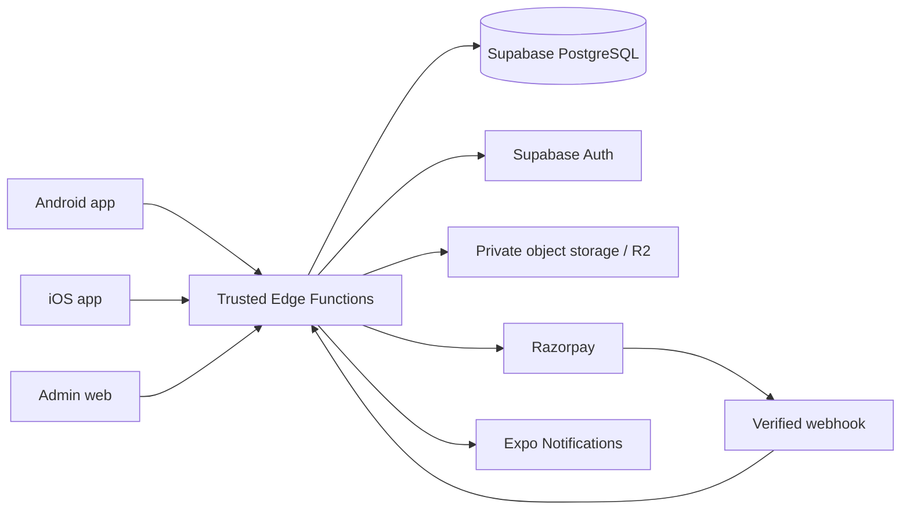

# SAMKRUSHI — Master Monorepo & End-to-End Product Specification

**Version:** 1.0 | **Project:** SAMKRUSHI farm-to-home fresh produce platform | **Initial market:** Hyderabad, Telangana, India

## 0. Read order and source of truth

Read this master file first, then:
1. `SAMKRUSHI_WEB_ADMIN_SPEC.md`
2. `SAMKRUSHI_ANDROID_APP_SPEC.md`
3. `SAMKRUSHI_IOS_APP_SPEC.md`

The source references are `SAMKRUSHI_ARCH_SPEC.md` (end-to-end architecture/product specification) and `SAMKRUSHI_ADMIN_DASHBOARD_SPEC.md` (first dashboard MVP). The dashboard MVP is the first operational milestone; procurement, inventory, orders and delivery are later phases, not assumed to exist in MVP.

The Android and iOS documents are separate implementation/release specifications, but both target one shared Expo React Native codebase. Do not fork mobile business logic.

## 1. Product and business model

SAMKRUSHI connects farmers/FPOs/approved suppliers to local households through a controlled sourcing, fulfilment and delivery operation.

Traditional chain:
`Farmer → mediator → wholesale/distribution market → vendors → local shops → household`

Samkrushi target flow:
`Farmer/FPO/supplier → staff records availability → customer app lists eligible products → customer orders → procurement plan → purchase/collection → goods receipt and quality inspection → accepted inventory → picking/packing → dispatch → early-morning delivery → support and reconciliation`

Farmers do not self-serve in the launch workflow; Samkrushi staff contact them and record their availability in the admin dashboard. Initial scope is a small Hyderabad delivery zone, limited supplier group and small catalog.

### 1.1 Critical inventory terminology

| Term | Meaning | Order-fulfilment status |
|---|---|---|
| Farmer-confirmed supply | Supplier's dated statement of what they expect to provide | Planning signal; not physical warehouse stock |
| Committed/allocated | Quantity committed to accepted customer orders | Not available for another order |
| Received | Physical quantity delivered to Samkrushi | Not sellable until inspected |
| Accepted | Received quantity that passed quality inspection | Creates eligible batch inventory |
| Reserved | Accepted stock held for an order | Not available to another checkout |
| Sellable / ATP | Backend-approved quantity available for a new order | Can be ordered |

Original dashboard MVP aggregation:
`MVP sellable quantity = SUM(active, valid farmer-confirmed quantities for product and business date)`

Inventory-backed availability after receiving is implemented:
`ATP = eligible accepted on-hand stock − active reservations`

When transitioning between these models, do not count farmer-confirmed supply and its accepted receipt as two stock pools. A dated supply record must not remain independently sellable after being converted to received stock or committed. Never permit negative sellable quantity. Label farmer-confirmed supply separately from received stock and ATP.

## 2. Three surfaces, two frontend codebases

| Deliverable | Codebase | Users | Main responsibility |
|---|---|---|---|
| Web admin dashboard | `apps/admin-web` — Next.js + TypeScript | Authorized staff | Manage business operations |
| Android customer app | Android build of `apps/mobile` — Expo/React Native | Customers | Browse, order, pay, track, support |
| iOS customer app | iOS build of `apps/mobile` — Expo/React Native | Customers | Same customer journey with iOS-native behavior |

### 2.1 Proposed monorepo

```text
samkrushi/
  apps/
    admin-web/
    mobile/                 # one app; Android and iOS builds
  packages/
    shared/                 # Zod schemas, domain types, constants, formatters
    config/
    ui-web/                 # optional web-only components
  supabase/
    migrations/
    seed/
    functions/
    tests/
  docs/
    specs/
    adr/
    api-contracts/
    runbooks/
  scripts/
  .env.example
  package.json
  pnpm-workspace.yaml
  turbo.json
  README.md
```

Use pnpm workspaces/Turborepo if appropriate after repository inspection. Recommended source architecture: Next.js; Expo React Native; Supabase PostgreSQL, Auth and Edge Functions; Zod; TanStack Query; Zustand; React Hook Form; Cloudflare R2 or approved object storage; Razorpay; Expo Notifications initially. Verify current compatible stable versions when implementation starts. Preserve working repository conventions rather than blindly replacing the stack.

### 2.2 System context



Backend/database is authoritative. Frontends must not decide final price, stock, payment status, reservations, fees, taxes, slot capacity or role permissions.

## 3. Roles and authorization

Platform roles:
- `customer`: own profile, addresses, orders and support.
- `super_admin`: configuration and user-role administration.
- `operations_admin`: suppliers, products, procurement, batches, inventory, orders and packing.
- `finance_admin`: refunds, settlements, supplier payments and financial reports.
- `dispatch_admin`: slots, delivery personnel, assignments and delivery exceptions.
- `support_agent`: minimum customer/order data needed for support.
- `rider`: assigned deliveries only.

Roles are server-controlled in a protected `user_roles` table or trusted claims. Never use customer-editable `is_admin`. Apply authorization in Edge Functions/server operations and database RLS. UI visibility is not security.

MVP role compatibility:
- Original `ADMIN` → `super_admin` only for the mapped dashboard permissions.
- Original `OPERATIONS` → initial `operations_admin`.
- Original `VIEWER` → explicit read-only permission set.
Do not silently grant finance, dispatch, support or user-role privileges during migration.

## 4. End-to-end workflows

### 4.1 Supplier onboarding
1. Admin creates farmer/supplier record.
2. Capture name, type (farmer/FPO/aggregator/approved source), primary and secondary contacts, full sourcing location, authorized contacts and status.
3. Capture product relationships, seasonality, indicative/agreed rates, lead time and quality requirements.
4. Upload applicable agreements/verification documents to private storage.
5. Record verification state, verifier and timestamp.
6. Activate after required checks. Keep purchase and supply history after deactivation. Restrict bank/payment details to finance roles.

### 4.2 Daily farmer-confirmed availability
1. Staff select the procurement/delivery business date.
2. Select active supplier and predefined catalog product.
3. Enter quantity, explicit unit, confirmation source, confirming staff member, timestamp, note and optional evidence.
4. Validate client and server side; enforce uniqueness or deliberate versioning for supplier-product-date.
5. Record history/reason for edits and deactivation.
6. Expired records are excluded; yesterday's quantity never carries forward.
7. Customer catalog and dashboard use the same backend availability service.

### 4.3 Customer order and checkout
1. Guest enters/selects PIN/address; server validates active service zone.
2. App displays eligible catalog SKUs for date/zone.
3. Customer selects fixed packs and adds to local cart.
4. Customer authenticates before order creation.
5. Customer chooses address, date/slot, payment method and substitution preference.
6. App sends cart lines, address ID, slot ID, payment method, preference and idempotency key to trusted `create-order`.
7. Server revalidates SKU, price, quantity, zone, slot, inventory/supply policy, minimum order, discounts and taxes.
8. Server transactionally creates order and reserves stock/slot.
9. Server creates Razorpay order for online payment, or confirms COD only when policy allows.
10. Webhook, not the client callback, confirms captured payment. App displays server-authoritative state.

### 4.4 Procurement, receipt and quality
1. Operations reviews demand/commitments, accepted stock and valid farmer supply without double counting.
2. Create PO with supplier, expected date, lines, requested quantity/unit and agreed cost.
3. PO lifecycle: `draft → sent → partially_received → received`, with allowed cancellation paths.
4. PO creation never adds stock. Multiple partial receipts are supported.
5. Receipt records received, accepted, rejected and damaged quantities separately, plus lot/batch, quality grade, notes, operator, time and evidence.
6. Only accepted quantity creates a saleable batch. Rejected/damaged stock never becomes available.
7. Do not treat harvest date as expiry date. Add sell-by/expiry only under approved policy.

### 4.5 Inventory, fulfilment and delivery
- Batches belong to product, supplier and optional fulfilment location.
- FEFO when reliable sell-by/expiry exists; otherwise documented FIFO.
- Expired, recalled, held or quality-blocked batches cannot be reserved.
- Every stock-changing action writes an auditable inventory movement; never overwrite stock directly.
- Picking queue groups by date/slot/zone. Picker records batch, picked and packed quantities.
- No silent substitution; use approved customer preference/consent.
- Only packed orders can be assigned for dispatch.
- Initially assign riders manually; automated route optimization and live GPS tracking are deferred.
- Rider sees assigned orders only, marks out-for-delivery, enters single-use OTP/proof, records failed reason and COD collection if allowed.
- Rider cannot edit price, order items, payment state or unrelated assignment.

### 4.6 Cancellation, refund, support and finance
- Customer cancellation may be a request once picking/packing begins.
- Approved cancellation releases reservation or creates return/wastage movement based on physical state.
- Refund initiated server-side; do not mark refunded before provider confirmation/reconciliation.
- Refund cannot exceed captured amount less previous refunds.
- COD refund depends on whether cash was collected and must be reconciled.
- Each cancellation/refund has actor and reason.
- Daily reconciliation includes captured payments, gateway settlements, refunds, COD, rider deposits, supplier invoices/payables, accepted batch costs, wastage and operating expenses.
- Reports distinguish actual from estimated cost/contribution.

## 5. Data conventions and business rules

- UUID primary keys.
- Timestamps stored UTC (`TIMESTAMPTZ`); business dates, cutoffs and delivery slots use `Asia/Kolkata`.
- INR stored as integer paise (`BIGINT`); no floating point for money.
- Quantities use suitable `NUMERIC` precision plus explicit unit.
- Phone numbers normalized to E.164 where practical; never primary key.
- Stable snake_case database identifiers; camelCase API JSON.
- Order items preserve name, SKU, pack size, unit, price and tax snapshots.
- Server time validates cutoffs; device time is display-only.
- Launch uses fixed packs/SKUs (e.g., 500 g, 1 kg, bunch, piece). Variable-weight post-payment settlement is deferred.
- Midnight cutoff and early-morning delivery are configurable operating settings, not constants. Slots, capacity, zones, fees, minimum order, COD, taxes, catalog, prices and policy text are admin-configurable.
- Do not invent production values. Seed development examples only.

## 6. Shared data domains

| Domain | Records |
|---|---|
| Identity | Auth users, customer/staff profiles, protected roles |
| Serviceability | Addresses, PIN mappings, zones |
| Catalog | Categories, products, SKUs, images, price history, tax configuration |
| Suppliers | Farmers/suppliers, contacts, locations, documents, verification, supplier-product links |
| Supply | Dated farmer-confirmed supply, status, actor and history |
| Procurement | Purchase orders, PO lines, supplier invoice references |
| Receiving | Goods receipts, receipt lines, quality inspections |
| Inventory | Fulfilment locations, batches, inventory movements, reservations |
| Commerce | Orders, immutable item snapshots, status history |
| Payment | Payment attempts/events, provider IDs, refunds, reconciliation |
| Delivery | Slots/capacity reservations, riders, assignments, OTP/proof, failed delivery |
| Customer care | Support tickets, deletion requests |
| Messaging | Device tokens, templates, transactional outbox, delivery attempts |
| Finance | Supplier payable, cash collection/deposit, expenses and report dimensions |
| Governance | Audit log, system settings, policy versions |

Bank data is finance-only; customers read only their own records; support sees minimum required data; riders are assignment-scoped.

## 7. APIs and trusted functions

Customer functions:
- `get-serviceability`
- `get-catalog`
- `get-product-detail`
- `get-delivery-slots`
- `create-order`
- `get-order-status`
- `request-order-cancellation`
- `request-refund`
- `request-account-deletion`

Admin functions: role-checked operations for staff, farmers/suppliers, catalog/SKUs, dated supply, POs, receipts, inspection, batches, inventory adjustments, orders, packing, slots, assignments, refunds, reports and settings.

Payment:
- `razorpay-webhook` verifies signature against exact raw body.
- Verify provider order ID to internal order, amount, currency and successful/captured event.
- Store unique provider event ID; handle duplicates/out-of-order events idempotently.
- Quarantine mismatches.
- Never log secrets or unnecessary PII/payment payloads.

Payment process death/client cancellation does not prove failure. Resolve with webhook/provider status. Reservation expiry must check provider state before release. If captured payment arrives after stock is legitimately released, create manual exception/refund; never silently oversell.

## 8. Security, privacy and non-functional requirements

- RLS plus server authorization for every protected action.
- No service-role, Razorpay, R2 or webhook secret in app bundles.
- HTTPS outside local development; restricted CORS; CSRF protection for cookie sessions; rate-limit login/OTP/uploads.
- Parameterized queries, input validation, output encoding, foreign keys, checks, uniqueness, indexes and optimistic concurrency.
- Soft deactivate or archive business records; no hard delete with financial history.
- Private documents/photos use signed access.
- Structured logs and request IDs; scrub tokens/secrets and unnecessary PII.
- Backups and tested restore procedure; dependency scanning and monitoring.
- Privacy, retention, deletion, food safety, packaging, tax, consumer protection and local permit requirements need appropriate Indian professional/authority review. A UI field does not establish compliance.
- Do not make unsubstantiated organic, pesticide-free or chemical-free claims.

## 9. Testing strategy

Unit: INR/paise, totals, quantity/unit/pack rules, availability aggregation/date expiry, payment/order transitions, FEFO/FIFO, refundable balance, OTP expiry.

Integration/database: RLS isolation, role matrix, concurrent stock reservations, concurrent slot capacity, idempotency, partial/rejected receipt, reservation consume/release, duplicate/out-of-order payment webhooks, delayed payment success, refund bounds, rider scope.

E2E:
1. Guest browses and adds to cart.
2. Customer authenticates and saves address.
3. Customer selects serviceable slot and orders.
4. Server reserves inventory/slot and initiates payment.
5. Webhook confirms order once.
6. Staff picks/packs/assigns rider.
7. Rider completes delivery with OTP.
8. Customer sees delivered order/history.
9. Finance report includes sale, cost and delivery allocation.

Also test COD, cancellation, refund, substitution declined, failed delivery, return-to-stock, account deletion request, offline recovery and notification failure.

## 10. Phased implementation

| Phase | Deliverable | Exit criteria |
|---|---|---|
| 0 | Repository inspection and plan | Actual stack/schema/auth understood; no code edits |
| 1 | Monorepo foundation | Workspaces, Next.js, Expo, shared package, strict TS, lint/tests/CI/README |
| 2 | Database/security | Migrations, constraints, indexes, RLS tests, generated DB types |
| 3 | Admin MVP | Staff auth, farmer management, catalog seed, dated supply, audit, customer catalog API |
| 4 | Procurement/inventory | Suppliers, POs, partial receipts, quality, batches, movement ledger |
| 5 | Customer browse/cart | Guest catalog, search, product detail, cart, auth, address and serviceability |
| 6 | Checkout/payments | Order create, atomic reservations, Razorpay, COD rules, webhook/refund foundations |
| 7 | Fulfilment | Picking, packing, substitution, delivery assignments and rider web route |
| 8 | Customer orders/support | History, tracking, cancellation, support, OTP, COD reconciliation |
| 9 | Production hardening | Reports, notifications/outbox, privacy/legal content, monitoring, backups, release |

Never generate the complete platform in one pass. Complete and test each phase before continuing.

## 11. AI coding-agent protocol

1. Read master and all three application specs before changing code.
2. Inspect the actual repository before every phase; report current state first.
3. Preserve working code; explain any necessary rewrite.
4. Implement only the requested phase.
5. Create migrations for schema changes and test from a clean database.
6. Generate TypeScript DB types from actual Supabase schema.
7. Use strict TypeScript; avoid `any`; validate untrusted inputs with shared Zod schemas.
8. Keep pricing, fees, stock, reservations, roles and payment state server-authoritative.
9. Never expose secrets in client bundles or logs.
10. Add tests for critical business rules before completion.
11. Do not adopt paid integrations or subscriptions without approval.
12. Keep README, `.env.example`, ADRs, migration notes and runbooks current.
13. List changed files, migrations, tests/results, setup steps, blockers and next phase.
14. Stop and ask when a business rule is ambiguous.

### Agent prompt 0 — inspect only
> Read the master file and all three app specs. Inspect the repository without modifying it. Report current stack, app structure, schema, migrations, auth, security, reusable modules, risks, missing prerequisites and founder decisions. Produce phased plan. Do not code.

### Agent prompt 1 — foundation
> Implement Phase 1 only. Set up pnpm/Turborepo if appropriate, Next.js admin, one Expo app for Android+iOS, shared package, strict TypeScript, lint/format, tests, CI, README and `.env.example`. Check compatible current stable versions. No business modules yet.

### Agent prompt 2 — database
> Implement Phase 2 only. Add sequential Supabase migrations, constraints, indexes, helper functions and RLS. Add role/RLS tests and generate TypeScript types from the migrated schema. Test from empty database.

### Agent prompt 3 — admin MVP
> Implement Phase 3 only using the web admin spec. Build staff auth/roles, farmers, seeded catalog, dated farmer availability, aggregation, audit and customer catalog API. Do not add orders/payments/warehouse in this phase.

### Agent prompt 4 — procurement and inventory
> Implement Phase 4 only. Build suppliers, PO, partial goods receipts, quality inspection, batches and inventory ledger. Only accepted physical quantity becomes stock. Add audit, FEFO/FIFO and concurrency tests.

### Agent prompt 5 — mobile browse
> Implement Phase 5 only in the shared Expo app. Build guest catalog, categories/search, detail, cart, auth, addresses, PIN serviceability and slot display. Follow both mobile specs. Do not calculate authoritative checkout totals on-device.

### Agent prompt 6 — checkout
> Implement Phase 6 only. Add server-authoritative order creation, atomic stock/slot reservations, Razorpay initiation/webhook verification, expiry/reconciliation, COD rules and refund foundation. Test duplicates, concurrent checkouts and delayed webhooks.

### Agent prompt 7 — fulfilment and launch
> Implement subsequent phases in reviewed increments. Build picking/packing, substitutions, rider assignment/OTP, customer history/tracking/support, finance reconciliation, notifications/outbox and production hardening. Run staging E2E and list open launch gates.

## 12. Founder decisions not to invent

Exact PIN coverage/zone; catalog/SKUs/prices/taxes; cutoff and slot windows/capacity; supplier rates/terms/quality checks; whether any interim checkout can reserve confirmed supply before physical receipt; minimum order/delivery fee/COD limits; substitution and cancellation/refund policies; label declarations; support contacts; data retention/deletion; hosting/payment/notification credentials. Configure these and record decisions in ADRs. Start with a small controlled Hyderabad pilot and expand only after reviewing repeat orders, service quality, wastage, contribution and cash runway.
