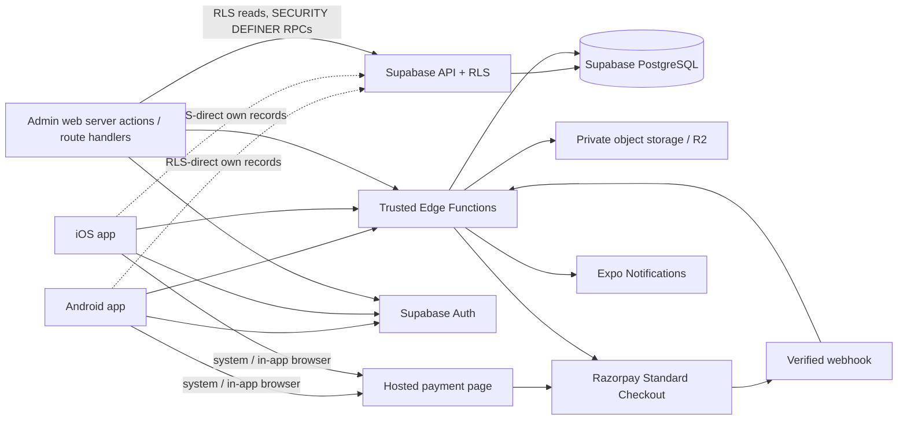

# SAMKRUSHI — Master Monorepo & End-to-End Product Specification

**Version:** 1.1 (amended 2026-11-23) | **Project:** SAMKRUSHI farm-to-home fresh produce platform | **Initial market:** Hyderabad, Telangana, India

## Amendments v1.1 — 2026-11-23

The founders approved the following decisions on 2026-11-23. They are now binding. Each is recorded in `docs/adr/`, and `docs/business-decisions.md` indexes them. This file was edited in place to match.

| Area | Change | Sections | ADR |
|---|---|---|---|
| Precedence | Master governs, then WEB_ADMIN/ANDROID/IOS. ARCH and ADMIN_DASHBOARD apply only where the master is silent. Master phases 0–9 are the only phase numbering | §0, §10, §11 | ADR-0001 |
| Availability | One ATP formula for all phases. Interim checkout **may** reserve open farmer-confirmed supply. One shared SQL availability function | §1.1, §4.2–§4.4, §7 | ADR-0007 |
| Release | Release 1 targets Android first. The iOS build config is maintained from Phase 1. The iOS store release follows Android | §2, §10 | ADR-0009 |
| Toolchain | Node.js 24 LTS only, pnpm workspaces + Turborepo, and a Docker-compatible runtime for local Supabase | §2.1, §13.13 | ADR-0002 |
| Roles/auth | New `viewer` role. Staff sign in with Supabase Auth email+password, backed by `staff_profiles` + `user_roles`. Audit is super_admin-only. Catalog writes are super_admin-only in the MVP | §3 | ADR-0005 |
| Checkout | Server quote step, then Razorpay Hosted/Standard Checkout first, with native SDK later and hosted kept as permanent fallback | §4.3, §7 | ADR-0008 |
| Conventions | Decimal-string quantities, integer paise, lowercase snake_case enums, shared response envelope, single append-only audit table | §5 | ADR-0003 |
| Data | `suppliers` + 1:1 `farmer_profiles`; `products` + `product_skus`; supply quantity rules; address `locality`; refund `manual_review` | §4, §5, §6 | ADR-0004, ADR-0006 |
| APIs | Complete customer operation list, with transport (Edge Function or RLS-direct) stated for each | §7 | ADR-0003 |
| Phases | Phase 2 schema scope defined. Rider OTP entry and customer delivery-OTP display both land in Phase 7 | §10 | ADR-0001 |
| Decisions | Resolved founder decisions marked. The open list is maintained in `docs/business-decisions.md` | §12 | — |
| New | Cross-cutting operational requirements | §13 | — |

## 0. Read order and source of truth

All specifications live in `docs/specs/`. Read this master file first, then:
1. `docs/specs/SAMKRUSHI_WEB_ADMIN_SPEC.md`
2. `docs/specs/SAMKRUSHI_ANDROID_APP_SPEC.md`
3. `docs/specs/SAMKRUSHI_IOS_APP_SPEC.md`
4. Accepted ADRs in `docs/adr/` (index: `docs/adr/README.md`) and `docs/business-decisions.md`.

The source references are `docs/specs/SAMKRUSHI_ARCH_SPEC.md` (end-to-end architecture/product specification) and `docs/specs/SAMKRUSHI_ADMIN_DASHBOARD_SPEC.md` (first dashboard MVP). The dashboard MVP is the first operational milestone. Procurement, inventory, orders and delivery are later phases and are not assumed to exist in the MVP.

**Precedence (ADR-0001):** this master file governs. The web admin, Android and iOS specs come next. ARCH and ADMIN_DASHBOARD apply only where the master and application specs are silent. Their own "source of truth" statements are superseded. Each source reference opens with a status block listing its superseded items. Accepted ADRs record binding decisions, and the spec text has been amended to match them. If an agent finds a residual contradiction, it must stop and raise it rather than choose.

**Phase numbering (ADR-0001):** master phases 0–9 (§10) are the only phase numbering. Phase tables, "Phase N" headings and "Prompt N" texts in the other documents describe sub-steps inside master phases. They must not be executed literally.

The Android and iOS documents are separate implementation/release specifications, but both target one shared Expo React Native codebase. Do not fork mobile business logic.

## 1. Product and business model

SAMKRUSHI connects farmers/FPOs/approved suppliers to local households through a controlled sourcing, fulfilment and delivery operation.

Traditional chain:
`Farmer → mediator → wholesale/distribution market → vendors → local shops → household`

Samkrushi target flow:
`Farmer/FPO/supplier → staff records availability → customer app lists eligible products → customer orders → procurement plan → purchase/collection → goods receipt and quality inspection → accepted inventory → picking/packing → dispatch → early-morning delivery → support and reconciliation`

Farmers do not self-serve in the launch workflow. Samkrushi staff contact them and record their availability in the admin dashboard. Initial scope is a small Hyderabad delivery zone, a limited supplier group and a small catalog.

Because customers order before goods are received, checkout reserves against open farmer-confirmed supply as well as against received stock (ADR-0007).

### 1.1 Critical inventory terminology

| Term | Meaning | Order-fulfilment status |
|---|---|---|
| Farmer-confirmed supply | Supplier's dated statement of what they expect to provide for a business date | Planning signal; not physical warehouse stock |
| Open confirmed supply | Active, non-expired farmer-confirmed supply for the business date, minus the quantity already received/converted against it | Reservable under the approved interim model (ADR-0007) |
| Committed/allocated | Quantity committed to accepted customer orders | Not available for another order |
| Received | Physical quantity delivered to Samkrushi | Not sellable until inspected. No longer counted as open supply |
| Accepted | Received quantity that passed quality inspection | Creates eligible batch inventory |
| Eligible on-hand | Accepted on-hand batch quantity, excluding held, recalled, expired and quality-blocked batches | Reservable |
| Reserved | Quantity held for an order against a supply pool (product + business date) or against a batch | Not available to another checkout. Never an inventory movement |
| Sellable / ATP | Backend-approved quantity available for a new order | Can be ordered |

Availability formula. One formula applies to every phase (ADR-0007):

`ATP(product, business_date, zone) = max(0, eligible accepted on-hand + open confirmed supply − active reservations)`

- ATP is calculated per product in its **base unit**, per business date (`Asia/Kolkata`) and per zone parameter. There is one shared pool at launch. The zone parameter exists so that adding zones later does not break the API.
- Open confirmed supply = the sum, over active non-expired dated supply records for that product and business date, of `max(0, confirmed quantity − quantity received/converted against the record)`. Once supply is received, it counts only as on-hand, and only its accepted part counts as eligible on-hand.
- Eligible on-hand excludes held, recalled, expired and quality-blocked batches.
- Reservations are held against a supply pool (product + business date) or against a batch. Reservations are never inventory movements.
- Until receiving (Phase 4) and reservations (Phase 6) exist, eligible on-hand and active reservations are both 0. During the Phase 3 admin MVP the formula therefore reduces to the original dashboard MVP aggregation: `SUM(active, valid farmer-confirmed quantities for product and business date)`.
- One shared SQL availability function serves the dashboard, `get-catalog`, `get-product-detail`, `get-checkout-quote` and `create-order`. No application, Edge Function or UI computes availability independently.
- Per-SKU availability is derived from the product pool (`floor(ATP / pack quantity)`, bounded by the SKU's order limits). Never sum unlike units.

Do not count farmer-confirmed supply and its accepted receipt as two stock pools. A dated supply record must not stay independently sellable after it is converted to received stock. Conversion reduces open supply and adds on-hand in one transaction, and moves that pool's reservations onto the resulting batch (ADR-0007). Never permit negative sellable quantity. Label farmer-confirmed supply separately from received stock and ATP.

## 2. Three surfaces, two frontend codebases

| Deliverable | Codebase | Users | Main responsibility |
|---|---|---|---|
| Web admin dashboard | `apps/admin-web` — Next.js + TypeScript | Authorized staff | Manage business operations; restricted rider route; public legal pages and hosted payment page |
| Android customer app | Android build of `apps/mobile` — Expo/React Native | Customers | Browse, order, pay, track, support |
| iOS customer app | iOS build of `apps/mobile` — Expo/React Native | Customers | Same customer journey with iOS-native behavior |

**Release sequencing (ADR-0009):** release 1 targets **Android first**. The iOS build configuration (per-platform identifiers, EAS profiles, entitlements) is maintained in parallel from Phase 1 and built in CI. The iOS App Store release follows the Android release. This changes only the store-release order. The shared code keeps full iOS parity, and no mobile business logic is forked.

### 2.1 Monorepo layout

```text
samkrushi/
  apps/
    admin-web/              # Next.js: staff dashboard, rider route, public legal pages, hosted payment page
    mobile/                 # one Expo app; Android and iOS builds
  packages/
    shared/                 # runtime-neutral Zod schemas, API envelope, domain types, constants, formatters
    config/                 # tsconfig, eslint, prettier presets
    ui-web/                 # optional web-only components
  supabase/
    config.toml
    migrations/
    seed/                   # dev-only synthetic seeds; never production data
    functions/
    tests/                  # pgTAP / supabase test db (RLS, role matrix, availability)
  docs/
    specs/                  # the six specifications (this file governs)
    adr/                    # accepted architecture/business decision records
    business-decisions.md   # index of approved decisions (links ADRs) and open founder decisions
    api-contracts/
    runbooks/
  scripts/                  # e.g. one-time super_admin bootstrap (ADR-0005)
  .github/workflows/
  .env.example
  package.json
  pnpm-workspace.yaml
  turbo.json
  README.md
```

Toolchain (ADR-0002): Node.js 24 LTS only, pnpm workspaces and Turborepo, and a Docker-compatible container runtime for the local Supabase stack. Recommended source architecture: Next.js; Expo React Native; Supabase PostgreSQL, Auth and Edge Functions; Zod; TanStack Query; Zustand; React Hook Form; Cloudflare R2 or approved object storage (the provider is an open founder decision); Razorpay Hosted/Standard Checkout first (ADR-0008); Expo Notifications initially. Verify current compatible stable versions when implementation starts. Preserve working repository conventions rather than blindly replacing the stack.

### 2.2 System context



The backend/database is authoritative. Frontends must not decide final price, stock, payment status, reservations, fees, taxes, slot capacity or role permissions. RLS-direct access is limited to the operations listed in §7.

## 3. Roles and authorization

Platform roles (`app_role`):
- `customer`: own profile, addresses, orders and support.
- `super_admin`: configuration, user-role administration, catalog writes (MVP) and audit history.
- `operations_admin`: suppliers, procurement, batches, inventory, orders and packing. Catalog read in the MVP. Catalog write is a later, explicit delegated permission.
- `finance_admin`: refunds, settlements, supplier payments, payment exceptions and financial reports.
- `dispatch_admin`: slots, delivery personnel, assignments and delivery exceptions.
- `support_agent`: minimum customer/order data needed for support.
- `rider`: assigned deliveries only.
- `viewer`: SELECT-only access to MVP dashboard data (overview, farmers/suppliers without restricted fields, dated supply, catalog). No audit access, no finance/bank fields, and no mutations. Founders still need to confirm whether viewer may see farmer phone numbers and photos. The dev default masks phone numbers and hides photos.

Roles are server-controlled in a protected `user_roles` table (`UNIQUE(user_id, role)`). One person may hold several roles. Never use a customer-editable `is_admin`. Apply authorization in Edge Functions/server operations and in database RLS. UI visibility is not security.

Staff identity (ADR-0005):
- Staff sign in with Supabase Auth email+password. There is no app-managed `password_hash`.
- `staff_profiles` (full name, `is_active`, `last_login_at`, audit columns) extends `auth.users` for staff. Customer `profiles` are separate.
- `apps/admin-web` uses `@supabase/ssr` HTTP-only, SameSite, Secure (outside local) cookies. It rejects any session without an active `staff_profiles` row and at least one active staff role. The rider route requires `rider`, and dashboard routes require a dashboard role.
- Customers, staff and riders share one Supabase Auth project. A customer sign-up never creates staff access. Staff roles are assigned only by a trusted server operation or the bootstrap script.
- Deactivated staff are banned in Supabase Auth and all their sessions are revoked. Every protected request also checks `is_active`.
- The first `super_admin` is created by a one-time server script using credentials supplied through the environment. No default password is ever committed. The script refuses to run if a `super_admin` already exists.
- The rider sign-in method is an open founder decision, because riders may not have email.

MVP role compatibility:
- Original `ADMIN` → `super_admin`, for the mapped dashboard permissions.
- Original `OPERATIONS` → `operations_admin`.
- Original `VIEWER` → `viewer`.
Do not silently grant finance, dispatch, support or user-role privileges during migration. Audit history is super_admin-only. Any later scoped audit view for operations is an explicit permission.

## 4. End-to-end workflows

### 4.1 Supplier onboarding
1. Admin creates a `suppliers` record. For `supplier_type = farmer`, admin also creates the 1:1 `farmer_profiles` record (ADR-0004).
2. Capture name, type (`farmer`, `fpo`, `aggregator`, `approved_source`, `other`; `wholesaler` is excluded unless founders approve), primary and secondary contacts, full sourcing location (address, village/locality, mandal, district, state, PIN), authorized contacts and status. For farmers, also capture land area and unit, and a private photo storage key.
3. Capture product relationships, seasonality, indicative/agreed rates, lead time and quality requirements.
4. Upload applicable agreements/verification documents to private storage (§13.9).
5. Record verification state, verifier and timestamp. Supplier status is `pending_verification`, `active`, `suspended` or `inactive`.
6. Activate after required checks. Keep purchase and supply history after deactivation. Restrict bank/payment details to finance roles. Whether MVP farmers may be active on creation is still a founder confirmation. The dev default follows ADMIN_DASHBOARD §16 (active on creation), in dev only.

### 4.2 Daily farmer-confirmed availability
1. Staff select the procurement/delivery business date. The default comes from the server's current `Asia/Kolkata` business date.
2. Select an active supplier (labelled "farmer" in the MVP UI) and a predefined catalog product.
3. Enter quantity in the product's base unit (any alternative entry unit is converted exactly on the server), confirmation source, confirming staff member, timestamp, note and optional evidence.
4. Validate client and server side. Enforce one active record per supplier + product + business date with a partial unique index. Versioning is used only if founders approve multiple lots per date.
5. Quantity rules: the DB enforces `CHECK (quantity >= 0)`. Create requires `> 0`. An update may set `0` only with a reason. Zero rows are excluded from availability.
6. Record history/reason for edits and deactivation, and use optimistic concurrency through a version column.
7. Expiry is computed from the business date in `Asia/Kolkata`. Past-date records are excluded, and yesterday's quantity never carries forward.
8. The customer catalog and dashboard use the same shared SQL availability function (§1.1).

### 4.3 Customer order and checkout
1. Guest enters/selects PIN/address. `get-serviceability` validates the active service zone.
2. App displays eligible catalog SKUs for the date/zone from `get-catalog`. It shows availability status and server-computed `maxOrderable` packs, never raw supply totals.
3. Customer selects fixed packs (SKUs) and adds them to the local cart. The cart is not a reservation.
4. Customer authenticates before quote and order creation. The local cart is revalidated after login (§13.4).
5. Customer chooses an address (with a server serviceability recheck), date/slot, payment method and substitution preference.
6. App calls `get-checkout-quote`. The server returns authoritative line prices, subtotal, discounts, delivery fee, taxes, total, COD eligibility and any price/availability/slot changes. The quote is non-binding and reserves nothing.
7. Customer reviews the quote. The app persists an idempotency key locally (§13.3), then sends cart lines, address ID, slot ID, payment method, preference, quote reference and idempotency key to `create-order`.
8. Server revalidates SKU, price, quantity, zone, slot, ATP, minimum order, discounts and taxes. If anything differs from the quote, it rejects the request with a quote-changed error that carries the new quote, and the app asks the customer to review again.
9. Server transactionally creates the order and immutable item snapshots. It reserves base-unit quantity through the shared availability function, from eligible on-hand batches or from the business date's supply pool (ADR-0007), and it reserves slot capacity.
10. For online payment, the server creates the Razorpay order and a short-lived hosted-checkout session. The app opens Razorpay Hosted/Standard Checkout in the system or in-app browser through `expo-web-browser` (ADR-0008). COD is confirmed only when policy allows.
11. Return from the browser (success, cancel, dismissal or process death) only triggers `get-order-status`. Captured payment is confirmed by the verified webhook, or by server-side provider reconciliation. The client callback is never authoritative. The app displays server-authoritative state.

### 4.4 Procurement, receipt and quality
1. Operations reviews demand/commitments, eligible accepted stock and open farmer supply without double counting (§1.1).
2. Create a PO with supplier, expected date, lines, requested quantity/unit and agreed cost.
3. PO lifecycle: `draft → sent → partially_received → received`, with allowed cancellation paths.
4. PO creation never adds stock. Multiple partial receipts are supported.
5. A receipt records received, accepted, rejected and damaged quantities separately, plus lot/batch, quality grade, notes, operator, time and evidence. A receipt line may reference the dated supply record(s) it fulfils.
6. Only accepted quantity creates a saleable batch. Rejected/damaged stock never becomes available. Posting a receipt converts the referenced supply exactly once: the received quantity leaves open supply, the accepted quantity enters eligible on-hand, and pool reservations move to the batch (ADR-0007).
7. Do not treat harvest date as expiry date. Add sell-by/expiry only under approved policy.

### 4.5 Inventory, fulfilment and delivery
- Batches belong to a product, a supplier and an optional fulfilment location. Quantities are in the product base unit.
- FEFO applies when reliable sell-by/expiry exists. Otherwise use documented FIFO.
- Expired, recalled, held or quality-blocked batches cannot be reserved. Active reservations on a batch that becomes ineligible return to the supply pool and are raised as an operations exception (ADR-0007).
- Every stock-changing action writes an auditable inventory movement. Never overwrite stock directly. Reservations are a separate commitment ledger.
- Recall traceability uses a `product_recall_batches` junction and a query of the orders that consumed affected batches (§13.10).
- The picking queue groups by date/slot/zone. The picker records batch, picked and packed quantities.
- No silent substitution. Use approved customer preference/consent. The option set is an open founder decision.
- Only packed orders can be assigned for dispatch.
- Riders are assigned manually at first. Automated route optimization and live GPS tracking are deferred.
- The rider sees assigned orders only, marks out-for-delivery, enters the single-use OTP/proof, records the failed reason, and records COD collection if allowed. The customer sees the delivery OTP in the app (`get-delivery-otp`, §13.6). Both land in Phase 7.
- The rider cannot edit price, order items, payment state or any unrelated assignment.

### 4.6 Cancellation, refund, support and finance
- Customer cancellation may become a request once picking/packing begins. `get-order-status` returns cancellation eligibility, computed by the server.
- Approved cancellation releases the reservation or creates a return/wastage movement, depending on physical state.
- Refunds are initiated server-side. Do not mark an order refunded before provider confirmation/reconciliation. Refund states: `requested`, `pending`, `processed`, `failed`, `cancelled`, `manual_review`.
- A refund cannot exceed the captured amount less previous refunds.
- A COD refund depends on whether cash was collected, and must be reconciled.
- Each cancellation/refund has an actor and a reason.
- Payment mismatches and captured-after-release cases go to the payment exception queue (§13.2).
- Daily reconciliation includes captured payments, gateway settlements, refunds, COD, rider deposits, supplier invoices/payables, accepted batch costs, wastage and operating expenses.
- Reports distinguish actual from estimated cost/contribution.

## 5. Data conventions and business rules

- UUID primary keys.
- Timestamps are stored in UTC (`TIMESTAMPTZ`). Business dates, cutoffs and delivery slots use `Asia/Kolkata`, and the current business date is always computed on the server.
- INR is stored as integer paise (`BIGINT`), with no floating point for money. APIs carry money as JSON integer paise (ADR-0003).
- Quantities use `NUMERIC` (default `NUMERIC(12,3)`), with per-product precision and an explicit unit. Supply, batches, movements and reservations are stored in the product **base unit**. Never sum unlike units. APIs serialize quantities as **decimal strings** (for example `"0.500"`), never JSON floats. Clients do not use JavaScript float arithmetic for quantities or money.
- Enums and controlled values are stored as lowercase snake_case (for example `kg`, `active`, `pending_verification`, `manual_review`) and returned the same way by APIs. Display labels or uppercase display codes are mapped only at the presentation/API boundary. API error codes are UPPER_SNAKE constants defined in `packages/shared` (ADR-0003).
- Phone numbers are normalized to E.164 where practical and are never a primary key.
- Database identifiers are stable snake_case. API JSON is camelCase. Every API uses the shared envelope `{ data, meta: { requestId, … } }` / `{ error: { code, message, details, requestId } }` (ADR-0003).
- Order items preserve snapshots of product name, SKU code, pack quantity, base unit, sale unit, price and tax classification.
- Server time validates cutoffs. Device time is display-only.
- Launch uses fixed packs (`product_skus`), for example 500 g, 1 kg, bunch or piece. Pack sizes are founder decisions. Variable-weight post-payment settlement is deferred.
- Dated supply quantity: DB `CHECK (>= 0)`. Create requires `> 0`. An update may set `0` only with a reason. Zero rows are excluded.
- Audit: one append-only `audit_logs` table with `actor_user_id`, `actor_role`, `action`, `entity_type`, `entity_id`, `reason`, redacted `before`/`after`, `request_id`, `source`, `created_at`, and `ip_hash` (nullable and unused until founders approve). No UPDATE/DELETE grants. Never store secrets or excess PII. Raw IP addresses are not stored.
- Addresses include `locality`. Latitude/longitude are nullable, consent-gated, and collected only for an approved purpose. Manual PIN entry is the baseline.
- Midnight cutoff and early-morning delivery are configurable operating settings, not constants. Slots, capacity, zones, fees, minimum order, COD, taxes, catalog, prices and policy text are admin-configurable and versioned where they are policies (§13.14).
- Do not invent production values. Seed development examples only. They must be clearly synthetic and live in dev-only seed files.

## 6. Shared data domains

| Domain | Records |
|---|---|
| Identity | Auth users; customer `profiles`; `staff_profiles`; protected `user_roles` (`app_role` includes `viewer`) |
| Serviceability | Addresses (with `locality`, consent-gated lat/long), PIN mappings, zones, temporary suspension |
| Catalog | Categories; `products` (base/inventory unit, precision, low-supply threshold); `product_skus` (stable SKU code, pack quantity in base unit, sale unit, `price_paise`, min/max/step); images; SKU price history; tax configuration |
| Suppliers | `suppliers` (`supplier_type`, status, verification); 1:1 `farmer_profiles`; contacts; locations; documents; supplier-product links; finance-only bank details |
| Supply | Dated farmer-confirmed supply (`supplier_id`, product, business date, base-unit quantity, confirmation source/by/at, evidence, reason, version), history, and links to the receipts that converted it |
| Procurement | Purchase orders, PO lines, supplier invoice references |
| Receiving | Goods receipts, receipt lines, quality inspections |
| Inventory | Fulfilment locations, batches, inventory movements, reservations (supply pool or batch), recalls and the `product_recall_batches` junction |
| Availability | One shared SQL availability function (§1.1), not callable by anonymous/customer roles directly |
| Commerce | Orders, immutable item snapshots, status history, checkout quotes |
| Payment | Payment attempts/events, hosted-checkout sessions, provider IDs, refunds (incl. `manual_review`), payment exceptions, reconciliation |
| Delivery | Slots/capacity reservations, riders, assignments, hashed OTP/proof, failed delivery |
| Customer care | Support tickets and customer-visible replies, deletion requests |
| Messaging | Device tokens, templates, transactional outbox, delivery attempts |
| Finance | Supplier payables, cash collection/deposit, expenses and report dimensions |
| Governance | Append-only `audit_logs`, system settings, policy versions, scheduled-job runs, rate-limit counters |

Bank data is finance-only. Customers read only their own records. Support sees the minimum required data. Riders are assignment-scoped. Viewer is SELECT-only on MVP dashboard data.

## 7. APIs and trusted functions

Transport rules (ADR-0003): the master's named Edge Functions are the customer API. RLS-direct access through the Supabase API is allowed only where this table says so. Every response uses the shared envelope and Zod contracts from `packages/shared`.

Customer operations:

| Operation | Transport | Caller | Notes | Phase |
|---|---|---|---|---|
| `get-app-config` | Edge Function | Public | Customer-safe settings only: store display name, support contacts, policy versions/links, feature flags (COD enabled, payment checkout mode), minimum supported app version. No secrets | 5 |
| `get-serviceability` | Edge Function | Public | PIN → zone, active/suspended/not-serviceable/invalid result, next eligible delivery dates | 5 |
| Category list | RLS-direct (`categories`, active rows) | Public | Category metadata only; no availability | 5 |
| `get-catalog` | Edge Function | Public | Products/SKUs for business date + zone, category filter, pagination, search query. Returns status (`available`/`limited`/`unavailable`) + `maxOrderable` packs per SKU from the shared availability function. Never returns raw supply totals | 3 (API), 5 (app) |
| Search | Edge Function (`get-catalog` with `q`) | Public | Server-side matching on product/category names. The client debounces and ignores stale responses | 5 |
| `get-product-detail` | Edge Function | Public | Product, images, SKUs, per-SKU availability for date/zone | 3 (API), 5 (app) |
| `get-delivery-slots` | Edge Function | Public/customer | Dates, windows, server-computed capacity state and cutoff | 5 |
| Profile read/update | RLS-direct (`profiles` own row; column grants on customer-editable fields only) | Customer | No role, verification or security fields | 5 |
| Address list | RLS-direct (own rows, excluding archived) | Customer | | 5 |
| `save-address` | Edge Function | Customer | Create/update/set default. Validates ownership, normalizes, runs the server serviceability check and stores the zone result | 5 |
| `archive-address` | Edge Function | Customer | Soft delete. Orders keep their address snapshot. The rule for addresses attached to active orders is a founder decision | 5 |
| `get-checkout-quote` | Edge Function | Customer | Non-binding server quote: lines, subtotal, discounts, delivery fee, taxes, total, COD eligibility, availability/slot issues, quote reference and expiry. Reserves nothing | 6 |
| `create-order` | Edge Function | Customer | Idempotent; transactional order, reservations and slot capacity; returns the payment action (hosted-checkout session or COD confirmation) | 6 |
| `resume-payment` | Edge Function | Customer | Returns a fresh hosted-checkout session for an owned `pending_payment` order whose reservation is still active. Never creates a new order | 6 |
| Order list | RLS-direct (own order-summary view) | Customer | Active/completed/cancelled groupings | 8 (confirmation screen in 6) |
| `get-order-status` | Edge Function | Customer owner or scoped staff | Safe summary; timeline derived server-side from order/payment/fulfilment history, including `cancelled`, `delivery_failed`, `returned` and refund states; `cancellationEligibility` (allowed, requires approval, reason) | 6, 8 |
| `request-order-cancellation` | Edge Function | Customer | Validates eligibility; performs an allowed cancellation or creates a request | 8 |
| `request-refund` | Edge Function | Customer | Creates a request. Only authorized staff/system process refunds | 8 |
| `get-delivery-otp` | Edge Function | Customer owner | Issues the single-use delivery OTP for an owned order in an eligible delivery state and returns the plaintext once. Only a hash is stored, so showing it again re-issues a new code (rate-limited; invalidates the previous one) | 7 |
| `create-support-ticket` | Edge Function | Customer | Order-ownership check, rate limit, optional attachment via `create-upload-url` | 8 |
| Ticket list/detail and public replies | RLS-direct (customer view excluding internal notes) | Customer | | 8 |
| `add-support-message` | Edge Function | Customer | Customer reply on own ticket | 8 |
| `create-upload-url` | Edge Function | Staff (3), customer (8) | Validates role, ownership, type, size and destination; random keys; private bucket | 3, 8 |
| `register-push-token` / `revoke-push-token` | Edge Function | Customer | Deduplicates a device token across users; revokes on logout or permission loss | 9 |
| `request-account-deletion` | Edge Function | Customer (recent auth) | Also used by the web fallback page (§13.8) | 8 (app), 9 (web) |

Admin operations: admin reads use RLS-protected queries/views, scoped by role (viewer is SELECT-only). Admin mutations go through `SECURITY DEFINER` RPCs or Edge Functions. RPCs use a fixed `search_path`, check the role inside, and write the audit row in the same transaction. Both are invoked only from Next.js server actions/route handlers, never from browser JavaScript with elevated keys. This covers staff (created and deactivated through the Supabase Auth admin API on the server), role assignment, farmers/suppliers, catalog/SKUs (super_admin in the MVP), dated supply, POs, receipts, inspection, batches, inventory adjustments, orders, packing, slots, assignments, refunds, payment exceptions, reports and settings. Where the master is silent, ARCH §15 names apply (`create-refund`, `reconcile-payments`, `post-goods-receipt`, `adjust-inventory`, `assign-delivery`, `confirm-delivery-otp`, `record-cod-collection`, `send-notification`, `admin-update-settings`).

Payment:
- Release 1 uses Razorpay Hosted/Standard Checkout (ADR-0008). `create-order`/`resume-payment` return a short-lived, single-use, opaque checkout-session token. The hosted payment page (on the approved domain) exchanges it for the server-created Razorpay order and opens Standard Checkout. The page then redirects to the app return link, which only triggers a status query.
- `razorpay-webhook` verifies the signature against the exact raw body.
- Verify the provider order ID against the internal order, amount, currency and successful/captured event.
- Store the unique provider event ID. Handle duplicate and out-of-order events idempotently.
- Quarantine mismatches into the payment exception queue (§13.2).
- Never log secrets or unnecessary PII/payment payloads.

Payment process death, browser dismissal or client cancellation does not prove failure. Resolve with the webhook or provider status. Reservation expiry must check provider state before release (§13.1). If captured payment arrives after stock was legitimately released, create a manual exception/refund. Never silently oversell.

## 8. Security, privacy and non-functional requirements

- RLS plus server authorization for every protected action.
- No service-role, Razorpay, R2 or webhook secret in app bundles. The Razorpay key ID is used by the hosted payment page, not by the mobile bundle.
- HTTPS outside local development; restricted CORS; `@supabase/ssr` HTTP-only SameSite cookies and CSRF protection for cookie sessions (server actions/route handlers); rate limits per §13.7.
- Parameterized queries, input validation, output encoding, foreign keys, checks, uniqueness, indexes and optimistic concurrency.
- Soft deactivate or archive business records. No hard delete of records with financial history.
- Private documents/photos use signed access (§13.9).
- Structured logs and request IDs. Scrub tokens, secrets and unnecessary PII (§13.11).
- Backups with a tested restore procedure; dependency scanning and monitoring.
- Privacy, retention, deletion, food safety, packaging, tax, consumer protection and local permit requirements need review by the appropriate Indian professional or authority. A UI field does not establish compliance.
- Do not make unsubstantiated organic, pesticide-free or chemical-free claims.

## 9. Testing strategy

Unit: INR/paise, decimal-string quantity parsing/serialization, totals, quantity/unit/pack rules, availability aggregation/date expiry, payment/order transitions, FEFO/FIFO, refundable balance, OTP expiry.

Integration/database: generated DB types from the migrated schema; migrations applied from an empty DB in CI; RLS isolation and the role matrix including `viewer` (pgTAP or `supabase test db`); admin-web rejection of customer-only and inactive-staff sessions; the shared availability function (multi-supplier sums, zero/expired/inactive exclusion, unit normalization, zone parameter, no double count across supply→receipt conversion, reservation re-pointing, floor at zero); concurrent stock reservations; concurrent slot capacity; idempotency; partial/rejected receipt; reservation consume/release; duplicate/out-of-order payment webhooks; delayed payment success; reservation expiry with provider check; refund bounds and `manual_review`; rider scope; delivery OTP issue/re-issue/attempt limits.

E2E:
1. Guest browses and adds to cart.
2. Customer authenticates and saves an address.
3. Customer gets a quote, selects a serviceable slot and orders.
4. Server reserves inventory/slot and opens a hosted-checkout session.
5. Webhook confirms the order once (also tested with browser dismissal and app process death).
6. Staff picks/packs/assigns a rider.
7. Customer views the delivery OTP in the app. The rider completes delivery with that OTP.
8. Customer sees the delivered order/history.
9. Finance report includes sale, cost and delivery allocation.

Also test COD, cancellation, refund, substitution declined, failed delivery, return-to-stock, account deletion request, offline recovery, pending checkout recovery, notification failure, accessibility (TalkBack, VoiceOver, Dynamic Type/font scaling, reduced motion) and platform back navigation.

## 10. Phased implementation

| Phase | Deliverable | Exit criteria |
|---|---|---|
| 0 | Repository inspection and plan | Actual stack/schema/auth understood; no code edits |
| 1 | Monorepo foundation | Node.js 24 LTS, pnpm/Turborepo workspaces, Next.js, one Expo app with Android **and** iOS build configs (ADR-0009), runtime-neutral shared package with API envelope contract, strict TS, lint/tests/CI, README, `.env.example`, `docs/specs`, ADRs |
| 2 | Database/security | Migrations, constraints, indexes, RLS tests, generated DB types. Scope: identity/roles (incl. `viewer`), `profiles`, `staff_profiles`, `suppliers` + `farmer_profiles`, catalog (`products`, `product_skus`, images, price history), dated supply, `audit_logs`, settings and policy versions, storage references, the shared availability function (MVP form). Later domains get migrations in their own phase |
| 3 | Admin MVP | Supabase Auth staff login + bootstrap script, role-aware shell with IST business date, farmer management, dev-only synthetic catalog seed, dated supply, shared availability function, audit, `get-catalog`/`get-product-detail` |
| 4 | Procurement/inventory | Supplier extensions, POs, partial receipts, quality, batches, movement ledger, reservation schema (supply pool or batch), supply→receipt conversion with no double count, recall junction |
| 5 | Customer browse/cart | `get-app-config`, guest catalog, search, product detail, cart and post-login revalidation, auth, secure session storage, profile, addresses (`save-address`), serviceability, slot display |
| 6 | Checkout/payments | `get-checkout-quote`, `create-order`, atomic reservations, Razorpay Hosted/Standard Checkout, `resume-payment`, pending checkout recovery, webhook, reservation-expiry and payment-reconciliation jobs, payment exception queue, COD rules, refund foundations (incl. `manual_review`) |
| 7 | Fulfilment | Picking, packing, substitution, delivery assignments, rider web route with OTP/proof entry and COD entry, **and** customer delivery-OTP display (`get-delivery-otp` + mobile screen) |
| 8 | Customer orders/support | History, tracking timeline incl. terminal/exception states, cancellation, support tickets, account deletion request, COD reconciliation |
| 9 | Production hardening and release | Reports, notifications/outbox dispatcher, push tokens, public legal pages incl. web account-deletion fallback, monitoring, backups/restore drill, runbooks, Android release 1. The iOS store release follows |

Never generate the complete platform in one pass. Complete and test each phase before continuing. Mobile spec phase tables map onto these phases (see each spec's implementation sequence).

## 11. AI coding-agent protocol

1. Read the master and all three application specs, plus accepted ADRs, before changing code. Follow ADR-0001 precedence.
2. Inspect the actual repository before every phase, and report current state first.
3. Preserve working code. Explain any necessary rewrite.
4. Implement only the requested master phase. Do not execute other documents' "Phase N"/"Prompt N" texts literally.
5. Create migrations for schema changes and test from a clean database.
6. Generate TypeScript DB types from the actual Supabase schema.
7. Use strict TypeScript and avoid `any`. Validate untrusted inputs with shared Zod schemas.
8. Keep pricing, fees, stock, reservations, roles and payment state server-authoritative.
9. Never expose secrets in client bundles or logs.
10. Add tests for critical business rules before completion.
11. Do not adopt paid integrations or subscriptions without approval.
12. Keep README, `.env.example`, ADRs, `docs/business-decisions.md`, migration notes and runbooks current.
13. List changed files, migrations, tests/results, setup steps, blockers and next phase.
14. Stop and ask when a business rule is ambiguous.

### Agent prompt 0 — inspect only
> Read the master file, all three app specs and accepted ADRs. Inspect the repository without modifying it. Report current stack, app structure, schema, migrations, auth, security, reusable modules, risks, missing prerequisites and founder decisions. Produce a phased plan. Do not code.

### Agent prompt 1 — foundation
> Implement Phase 1 only. Set up pnpm/Turborepo on Node.js 24 LTS (ADR-0002), the Next.js admin, one Expo app with separate Android and iOS build/release configs (ADR-0009), a runtime-neutral shared package with the API envelope contract (ADR-0003), strict TypeScript, lint/format, tests, CI, README and `.env.example`. Check compatible current stable versions. No business modules yet.

### Agent prompt 2 — database
> Implement Phase 2 only, with the scope in §10. Add sequential Supabase migrations, constraints, indexes, helper functions, the shared availability function (MVP form) and RLS. Add role/RLS tests including `viewer`, and generate TypeScript types from the migrated schema. Test from an empty database.

### Agent prompt 3 — admin MVP
> Implement Phase 3 only, using the web admin spec. Build Supabase Auth staff login with `staff_profiles`/`user_roles` and the bootstrap script, farmers (`suppliers` + `farmer_profiles`), the dev-only seeded catalog (`products` + `product_skus`), dated farmer availability, the shared availability function, audit, and the `get-catalog`/`get-product-detail` Edge Functions. Do not add orders/payments/warehouse in this phase.

### Agent prompt 4 — procurement and inventory
> Implement Phase 4 only. Build supplier extensions, PO, partial goods receipts, quality inspection, batches, the inventory ledger, the reservation schema (supply pool or batch) and supply→receipt conversion without double counting (ADR-0007). Only accepted physical quantity becomes on-hand stock. Add audit, FEFO/FIFO, recall junction and concurrency tests.

### Agent prompt 5 — mobile browse
> Implement Phase 5 only in the shared Expo app. Build app config, guest catalog, categories/search, detail, cart with post-login revalidation, auth with secure (chunked/encrypted) session storage, profile, addresses via `save-address`, PIN serviceability and slot display. Follow both mobile specs. Do not calculate authoritative checkout totals on-device.

### Agent prompt 6 — checkout
> Implement Phase 6 only. Add `get-checkout-quote`, server-authoritative order creation, atomic stock/slot reservations, Razorpay Hosted/Standard Checkout sessions (ADR-0008), `resume-payment`, webhook verification, reservation-expiry and reconciliation jobs, the payment exception queue, COD rules and refund foundations. Test duplicates, concurrent checkouts, browser dismissal, process death and delayed webhooks.

### Agent prompt 7 — fulfilment and launch
> Implement Phases 7–9 one at a time, in reviewed increments. Build picking/packing, substitutions, rider assignment/OTP together with the customer delivery-OTP display (Phase 7); customer history/tracking/support/account deletion and COD reconciliation (Phase 8); then finance reports, notifications/outbox, legal pages, monitoring and production hardening (Phase 9). Run staging E2E and list open launch gates. Release Android first; iOS follows.

## 12. Founder decisions not to invent

Status as of 2026-11-23. The full, phase-grouped open list with dev-only placeholders is maintained in `docs/business-decisions.md`.

| Decision | Status |
|---|---|
| Whether any interim checkout can reserve confirmed supply before physical receipt | **Resolved — yes** (ADR-0007) |
| Razorpay mobile integration mode | **Resolved — Hosted/Standard Checkout first; native SDK later; hosted remains fallback** (ADR-0008) |
| Platform release order | **Resolved — Android release 1 first; iOS store release follows** (ADR-0009) |
| Where decisions are recorded | **Resolved — ADRs, indexed by `docs/business-decisions.md`** (ADR-0001) |
| Staff auth model, viewer role, audit and catalog-write scope | **Resolved** (ADR-0005). Viewer visibility of farmer phone/photo remains open |
| Supplier types | **Resolved** — `farmer`, `fpo`, `aggregator`, `approved_source`, `other`; wholesaler only if founders approve (ADR-0004) |
| Exact PIN coverage/zone | Open |
| Catalog/SKUs/pack sizes/prices/taxes | Open |
| Cutoff and slot windows/capacity | Open |
| Supplier rates/terms/quality checks | Open |
| Supply shortfall handling when accepted receipt is below reserved quantity | Open (new; ADR-0007) |
| Minimum order/delivery fee/COD limits | Open |
| Substitution and cancellation/refund policies | Open |
| Customer catalog exposure (status + `maxOrderable` is the dev default) | Open for founder revision |
| Farmer active on creation; required farmer fields | Open |
| Label declarations | Open |
| Support contacts | Open |
| Data retention/deletion; audit IP hash | Open |
| Hosting, domain, payment and notification credentials | Open |

Configure these values and record decisions in ADRs. Start with a small, controlled Hyderabad pilot. Expand only after reviewing repeat orders, service quality, wastage, contribution and cash runway.

## 13. Cross-cutting operational requirements

### 13.1 Scheduled jobs

Mechanism: Supabase `pg_cron`, invoking database functions directly or Edge Functions through `pg_net`, unless a later ADR changes this. Every job is idempotent, single-flight (advisory lock), and records a run row (start, end, outcome, counts, error) with a request ID.

| Job | Phase | Behavior |
|---|---|---|
| `expire-reservations` | 6 | Selects active reservations past `expires_at`. Before releasing one, checks provider/payment-event state: release only if no capture exists and none is being processed; otherwise route to reconciliation. Reservation state changes are transactional |
| `expire-checkout-sessions` | 6 | Invalidates unused hosted-checkout session tokens past their TTL |
| `reconcile-payments` | 6 | Compares pending/ambiguous payments with provider status and settlement data. Raises payment exceptions; never silently confirms or fails |
| `dispatch-outbox` | 9 | Sends notification outbox rows with retry/backoff. Delivery failure never reverses business state. Deactivates invalid tokens |
| `sweep-orphan-objects` | 3 | Deletes storage objects no longer referenced (for example replaced farmer photos), after a grace period |

Durations, TTLs and schedules are configurable settings. The reservation expiry duration is a founder decision; dev uses a short placeholder.

### 13.2 Payment exception and quarantine view

A `payment_exceptions` record is created for: amount or currency mismatch, unknown provider order, capture after reservation release, duplicate capture, refund mismatch, and any webhook that fails validation after signature verification. Finance/super_admin roles see an exception queue with the order, the provider IDs, the expected vs. received amounts, and a timeline. Resolution actions are re-reserve (if ATP allows), manual refund through `create-refund`, or resolve with a reason. Every action is audited. An unresolved exception blocks automatic state changes on that order.

### 13.3 Pending checkout recovery (mobile)

Before calling `create-order`, the app persists `{ idempotencyKey, quoteReference, createdAt }`. After the response it adds `{ orderId, sessionExpiresAt }`. The record is non-secret, stored locally, and contains no payment data. On launch, resume or network recovery, if a pending record exists, the app calls `get-order-status`. It then shows the outcome, offers `resume-payment` while the reservation is active, or clears the record on a terminal state. Retrying with the same idempotency key returns the same order. The app never creates a second order automatically.

### 13.4 Guest cart reconciliation

The cart is local-only (no server cart at launch) and survives authentication. After login, and before the quote, the app revalidates every line against `get-catalog`/`get-checkout-quote`. Lines with an inactive SKU, a changed price, an unavailable SKU or a quantity above `maxOrderable` are flagged with a clear message for the customer to resolve. They are never silently dropped or changed.

### 13.5 Secure session storage (mobile)

Supabase sessions may exceed platform secure-store value-size limits. Use a maintained large-secure-store pattern: either encrypt the session with a key held in Keychain/Keystore (`expo-secure-store`) and store the ciphertext in app storage, or chunk the session across secure-store entries. Never log tokens. Clear the session on logout and on a refresh-token failure.

### 13.6 Delivery OTP delivery to the customer (Phase 7)

When an order reaches an eligible delivery state, the customer's order detail screen offers "Show delivery code" through `get-delivery-otp`. The server issues a single-use OTP, stores only its hash with expiry and attempt count, and returns the plaintext only to the authenticated owner. Re-issue is rate-limited and invalidates the previous code. The OTP never appears in push payloads, lock-screen text, logs or ordinary API responses. The rider enters it through `confirm-delivery-otp`. Additional channels (such as SMS) and the OTP length/expiry are founder decisions, held as configurable settings.

### 13.7 Rate limits

Rate-limit staff login, customer OTP request/verify, uploads, `get-checkout-quote`, `create-order`, `resume-payment`, support tickets/messages, `get-delivery-otp`, `confirm-delivery-otp`, push-token registration and account-deletion requests. Use limits beyond the Supabase defaults where needed, implemented with DB-backed counters or an edge layer. Limits are configurable settings: dev values are placeholders and production values need founder/ops approval. Exceeding a limit returns HTTP 429 with error code `RATE_LIMITED` and `retryAfter` in `details`.

### 13.8 Public legal pages and web account-deletion fallback

`apps/admin-web` hosts a public route group at `/privacy-policy`, `/terms`, `/refunds-and-cancellations`, `/delivery-policy`, `/contact` and `/delete-account`. Until founder/legal-approved text exists, each page renders "Content pending founder/legal approval". `/delete-account` is the web fallback that store review requires. The customer verifies their identity with the approved customer auth method, and the request enters the same `request-account-deletion` workflow. The public route group never grants staff access, and staff-role checks apply only to dashboard and rider routes.

### 13.9 Private document and photo storage

Farmer photos, supplier agreements/verification documents, receipt/quality evidence and support attachments live in private buckets. Rules: random object keys (never user filenames); server-side content sniffing plus type/size limits (dev default 5 MB JPEG/PNG/WebP, pending founder decision); strip location metadata from images where practical; short-lived signed URLs issued only after a role/ownership check; orphan cleanup when an object is replaced (§13.1); access audit for supplier documents and farmer photos. Never use a public CDN path for private objects. Product images may use a public read path.

### 13.10 Product recall traceability (Phase 4)

`product_recalls` + `product_recall_batches(recall_id, batch_id)`, plus a query of the orders and customers that consumed stock from affected batches (through consumed reservations and sale movements). Placing a batch under recall makes it ineligible immediately (§4.5). The recall procedure itself is a founder decision.

### 13.11 Health, logging, monitoring and runbooks

- Health endpoints: admin-web and a `health` Edge Function, each reporting DB reachability and version only.
- Structured JSON logs with a `requestId` that is propagated from clients (header) → Edge Functions/server actions → audit rows. PII and secrets are scrubbed.
- Error monitoring (tool choice open), dependency scanning, backup status alerts and alerts for scheduled-job failure.
- Runbooks in `docs/runbooks/`: those in ARCH §19.5, plus super_admin bootstrap/recovery, scheduled-job failure, payment exception triage and a backup restore drill.

### 13.12 Business date display in admin

The admin header shows the current `Asia/Kolkata` business date as returned by the server. Date pickers default to it. Within a configurable window around midnight, screens show the selected business date prominently and warn when it differs from the current one. Business logic never uses the browser clock.

### 13.13 Monorepo tooling constraints

- Node.js 24 LTS only. pnpm workspaces + Turborepo. A Docker-compatible runtime for the local Supabase stack (ADR-0002).
- pnpm with Expo Metro: use the documented Expo monorepo configuration (node-linker/hoisting settings and Metro workspace resolution as required by the chosen Expo SDK).
- Align React versions between Next.js and Expo where the chosen versions allow. Otherwise isolate them per app and never share React components across web and mobile through `packages/shared`.
- `packages/shared` is runtime-neutral: pure TypeScript + Zod, with no Node, DOM or React Native imports. It is consumable by Deno-based Supabase Edge Functions through an import map or bundling.
- Generated Supabase types are emitted into a shared package and checked in CI against the migrated schema.

### 13.14 Settings and policy versions

Typed, audited settings cover store/support contacts, zones/PINs, slots/capacity/cutoff, minimum order, delivery fee, COD limits, store hours, rate limits, job TTLs, the temporary pause switch and tax configuration (after professional review). Substitution, cancellation, refund and delivery policies are stored as versions, and orders record the version shown at checkout. `get-app-config` exposes only customer-safe values.
